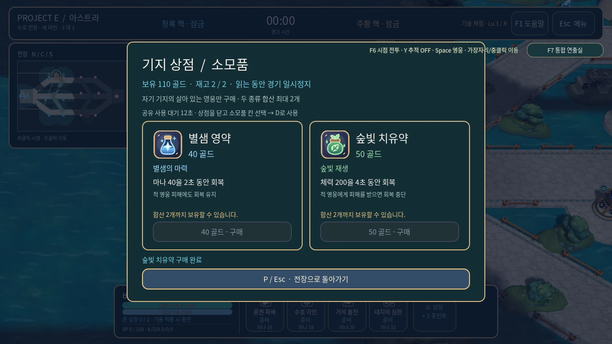
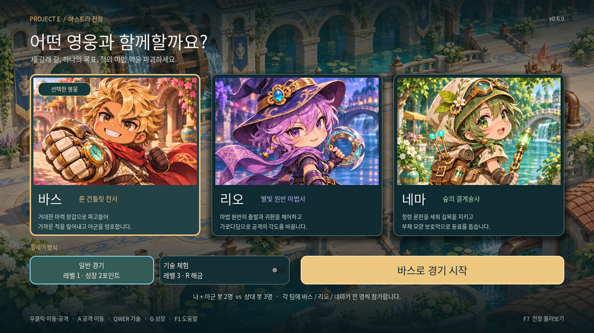
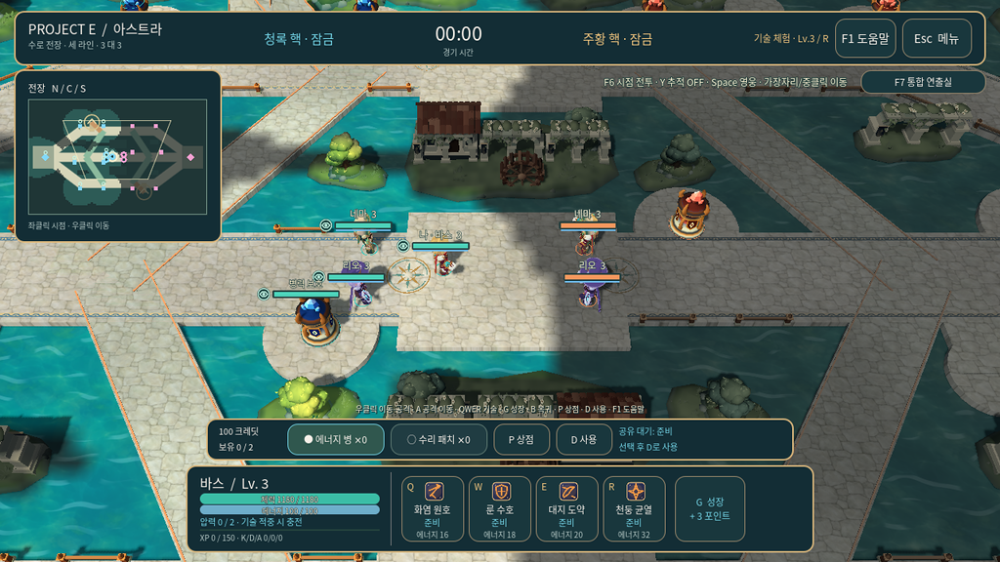

# Project E — 아스트라 수로 전장

Godot 4.7.2 Standard로 만드는 독립 실행형 PC AOS다. 현재 실행판은 **사람 1명과 봇 5명이 싸우는 오프라인 3 대 3**이며, 세 라인에서 성장하고 포탑을 밀어 상대 핵을 파괴하는 경기 흐름을 제공한다.

## 현재 기준 V7

패시브 3개와 QWER 12개를 룬 건틀릿·별빛 원반·숲의 결계 콘셉트로 구성했다. 스킬 이름과 실제 판정 설명은 공용 데이터에서 HUD와 F7 연출실에 연결한다. 바스는 룬과 대지 충격, 리오는 왕복 혜성과 성좌, 네마는 정령목과 덩굴을 사용한다. 화면 오른쪽 위의 버전은 `v0.7.0`이다. [V7 개편 구성](doc/design/27-fantasy-skills-v7.md)

| 영웅 | 패시브 | Q | W | E | R |
|---|---|---|---|---|---|
| 바스 | 룬 심장 | 룬권 파쇄 | 수호 각인 | 거석 돌진 | 대지의 심판 |
| 리오 | 별의 순환 | 왕복 혜성 | 별무리 닻 | 별빛 도약 | 삼각 성좌 |
| 네마 | 숲의 품 | 정령목 심기 | 덩굴 물결 | 잎새의 가호 | 고대숲의 결박 |

별샘 영약은 마나 40을 2초 동안, 숲빛 치유약은 체력 200을 4초 동안 회복한다. 두 아이템에 전용 아이콘과 회복 연출·사용음을 연결했다. 숲빛 치유약은 적 영웅의 유효 피해를 받으면 회복이 중단되며, 두 아이템은 사용 대기시간 12초를 공유한다. [상점·회복 규칙](doc/design/05-growth-and-economy.md)



33개 행동 회귀 검사, 실제 PCK의 22개 화면, Windows 실행 기동, 12개 스킬의 판정·시야·성능 확인 결과를 검증 문서에 기록했다. [V7 검증과 실제 화면](doc/design/verification/2026-11-06-v7-verification.md) · [V7 변경과 최신 빌드](https://github.com/herothgf-cell/project-e/pull/9)

## V6 화면·카메라 기반

선택 화면은 운하 원화와 세 영웅의 일러스트를 크게 배치했다. 일반 경기와 기술 체험을 별도 버튼으로 고르고, 선택한 영웅과 시작 버튼을 바로 확인할 수 있다. 아래 이미지는 V6 화면·카메라 개선 기록이다.



경기는 영웅 추적 카메라로 시작한다. 화면 안쪽에서 가장자리로 마우스를 옮기거나 가운데 버튼으로 드래그하면 자유 시점으로 전환한다. Y로 추적을 전환하고 Space로 영웅에게 복귀한다. 화면 가장자리 32픽셀에서 이동 속도가 점차 커지고, 네 방향에 같은 규칙을 적용한다.

전투 HUD는 중앙 하단의 조작부와 소모품 바로 정리했다. 미니맵, 카메라 안내, F7 버튼, 대상 정보와 알림의 배치를 조정했다. 일반 근접·원거리 병사는 적의 마지막 1 HP를 남긴 뒤 다른 대상을 찾거나 전진한다. 영웅·공성 병사·포탑은 처치할 수 있다.



1280×720, 1366×768, 960×540 선택 화면과 960×540 전투 HUD를 배포 PCK에서 촬영했다. 경기 촬영에는 위치를 고정한 재현 장면을 사용했다. [수정 전후와 검증 기록](doc/design/verification/2026-11-06-v6-verification.md)과 [PDF 적용 근거](doc/design/26-cot-reference-v6.md)에 구현 판단과 실행 조건을 남겼다.

| 영역 | 현재 구현 |
|---|---|
| 전장 | 3개 라인, 연결 통로 4개, 포탑 12개, 핵 2개, XP 셀 6개, 높이 2.4m 고지 2곳과 진입 경사로 4개 |
| 영웅 | 바스·리오·네마의 기본 공격, 패시브, Q/W/E/R, 레벨 성장과 궁극기 해금 |
| 경기 | 병력 생성·라인 교전·공성·핵 파괴 승리, 사망·부활, 사람 1명과 봇 5명 |
| 경제 | 20/30/40 XP 셀, 공유 보상, 성장 투자, 기지 회복, 상점과 소모품 |
| 봇 | 라인 전투·성장·복귀, 관측한 셀 수집, 아군 지원과 핵 방어, 소모품 구매·사용 |
| 전투 표시 | 시야·고저차·벽 판정에 맞춘 경고와 효과, HUD·미니맵·상태 표시 |
| 캐릭터 표현 | 텍스처가 포함된 GLB 3종, 영웅당 10개 동작 클립, 영웅별 Q/W/E/R 12개 동작과 효과 |
| 음향·검토 | 전투용 WAV 5개, F6 전장 보기와 F7 독립 검토실 |

V6는 28개 행동 회귀 검사의 4,743개 항목과 배포 PCK 화면·입력 검사 73개를 통과했다. Windows CI에서 실행 파일의 120프레임 기동도 확인했다. 사용자 PC의 장시간 수동 플레이와 GPU 성능 검증은 남아 있다. [V6 검증 기록](doc/design/verification/2026-11-06-v6-verification.md)

## 실행

1. Godot 4.7.2 Standard에서 `game/project-e/project.godot`를 가져온다.
2. 최초 자산 가져오기가 끝나면 F5로 실행한다.
3. 바스·리오·네마 중 영웅을 선택해 경기를 시작한다. 개별 동작은 F7 검토실에서 확인한다.

Windows 배포본을 사용하는 경우 `.exe`와 함께 제공된 `.pck`를 같은 폴더에 둔다. V7 배포·내보내기 검증은 검증 기록과 최신 빌드에서 확인한다. [V7 검증 기록](doc/design/verification/2026-11-06-v7-verification.md) · [V7 변경과 최신 빌드](https://github.com/herothgf-cell/project-e/pull/9)

| 입력 | 동작 |
|---|---|
| 우클릭 | 이동 또는 대상 공격 |
| A → 좌클릭 | 공격 이동 |
| Q/W/E/R → 좌클릭 | 스킬 선택과 조준 확정 |
| Esc / S | 조준 취소 / 정지 |
| G / B | 성장 패널 / 기지로 걷기 복귀 |
| P / D | 상점 / 선택한 소모품 사용 |
| F1 | 경기 도움말 |
| F6 / F7 | 전장 보기 / 독립 검토실 |
| Y / Space | 카메라 추적 전환 / 조작 영웅으로 초점 이동 |
| 마우스 휠 / 가운데 버튼 드래그 | 확대·축소 / 카메라 이동 |

스킬 슬롯·소모품 선택 등 상세 조작은 게임 도움말과 [UI·조작 문서](doc/design/06-ui-and-controls.md)를 따른다. 검토실은 별도 전투 상태를 사용하므로 검토실의 재생이 진행 중인 경기 상태를 바꾸지 않는다.

## 설계와 제작 자료

- [설계 문서 목차](doc/design/README.md): 경기·맵·전투·AI·성장·UI·아트의 요소별 기획
- [V5 수로 전장 제작 안내](doc/design/25-illustrated-canal.md): 자산 목록, 모델 편집 계약, 실제 화면과 재현 명령
- [캐릭터 기획](doc/design/characters/README.md): 바스·리오·네마의 전투 역할과 시각 방향
- [설계와 실행판의 차이](doc/design/10-differences.md), [남은 개발](doc/design/11-remaining-development.md)
- [V4 전투 표현](doc/design/23-fantasy-v4-combat-presentation.md), [V4 자산 안내](doc/design/24-fantasy-v4-asset-guide.md): 이전 단계의 제작 기록

영웅의 얼굴·의상 WebP 6장과 복구된 Python 생성기 2개로 영웅 3종과 환경 11종의 GLB를 다시 만들었다. 14개 모두 V5 커밋 `6bd03beb`의 파일과 바이트 단위로 일치한다. [모델 수정·재생성 방법](doc/design/25-illustrated-canal.md#5-모델과-텍스처-수정-계약) · [입력·결과 해시와 실행 환경](doc/design/verification/2026-11-06-v5-model-reproduction.md)

## 자동 확인

저장소 루트에서 실행한다.

```sh
python tools/check_godot.py --godot /absolute/path/to/godot
python tools/check_art_assets.py
python tools/check_audio_assets.py
python -m unittest discover -s tools/tests -p 'test_package_windows.py'
```

검증 도구는 자산 가져오기, 전투·입력·표현 회귀 검사, 시작 장면 실행 및 배포 관련 규칙을 확인한다. 자동 통과가 사용자 PC의 프레임 성능·재미·사람 경기 밸런스·온라인 연결을 대신하지 않는다. 공개 시안, 역사적 검증 수치, 이번 실행 증거는 [설계 목차](doc/design/README.md)에서 구분한다.
