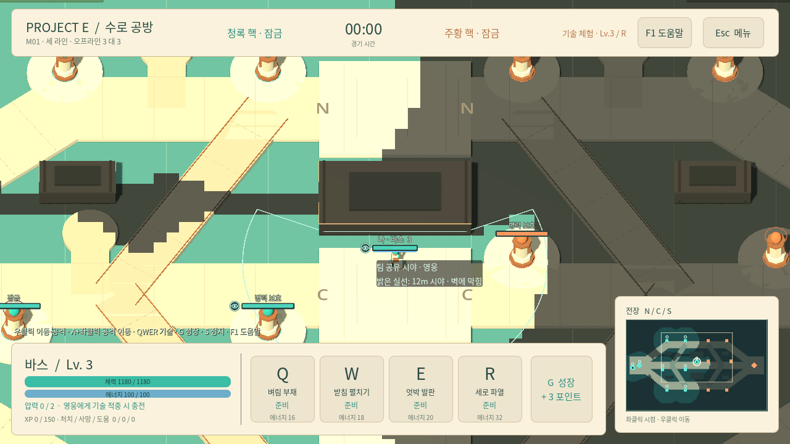

# Project E — 수로 공방

**세 라인의 지원 판단, 짧은 스킬 교전, 경기 중 성장을 중심으로 하는 독립 PC용 3대3 액션 AOS.** Godot로 개발하며 Steam 출시를 목표로 한다.

현재 실행판은 **바스·리오·네마 중 한 명을 조작하고 봇 5명과 플레이하는 오프라인 프로토타입**이다. 미니언 진격, 영웅 교전, 성장, 외곽탑→내곽탑→핵 파괴를 한 판으로 연결한다. 참고작의 재미 구조를 출발점으로 삼되, 영웅·기술·수로 도시·공방 도구와 표현은 새롭게 설계했다.

## 현재 상태

| 항목 | 내용 |
|---|---|
| 기준일 | 2026-10-27 · 다음 로컬 플레이테스트 기능 반영 |
| 엔진 | **Godot 4.7.2 Standard + GDScript**, Compatibility, 30Hz 로컬 판정 |
| 참가자 | 사람 1명 + 아군 봇 2명 + 상대 봇 3명; 팀별 세 영웅 1명씩 |
| 전장 | M01 수로 공방, N/C/S 세 라인, 지원 연결로, 타워 12개와 핵 2개 |
| 전투 | 기본 공격, 세 영웅의 패시브·Q/W/E/R, 보호막·상태 이상·사망·부활 |
| 성장 | 20/30/40 XP 셀·레벨·투자 포인트·R 해금; 일반 경기와 기술 체험 분리 |
| 새 조작·시야 | A 공격 이동, 시야원 표식과 전장/미니맵 음영, 포탑 사거리8.5m, F1 안내 |
| 승패 | 외곽/내곽/핵 잠금, 병력 유무에 따른 공성 보호, 핵 파괴·무승부·재시작 |
| 기획서 | 요청 경로인 [doc/design](doc/design/README.md)에 요소별 기획 |
| 검증 | [실제 실행 명령·통과 범위·자연 봇 경기 결과](doc/design/09-verification.md) |

초기 로드맵 M0–M2 일부를 오프라인에서 연결했다. Windows 독립 실행 ZIP을 제작했고 [재현 가능한 패키징 절차](docs/technical/04-windows-build.md)와 자동 검증 도구를 제공한다. 실제 Windows PC의 실행·조작, 사람 경기, 인터넷 대전과 Steam 연동은 각각 별도 확인이 필요하다.

## 바로 실행하기

**Windows 실행 패키지를 받았다면:** ZIP 전체를 풀고 **ProjectE.exe**를 실행한다. ProjectE.pck를 같은 폴더에 둔다. 이 패키지로 플레이할 때는 Godot 에디터가 필요 없다. 아래는 소스를 직접 여는 방법이다.

1. **Godot 4.7.2 Standard**를 준비한다. .NET 버전은 필요하지 않다. [공식 버전 보관함](https://godotengine.org/download/archive/4.7.2-stable/)을 참고한다.
2. 저장소를 내려받거나 기존 저장소에서 최신 main을 받는다.
3. Godot 프로젝트 관리자에서 **Import** → [game/project-e/project.godot](game/project-e/project.godot)을 선택한다.
4. 프로젝트를 연 뒤 **F5**를 누른다. 영웅 선택 화면에서 바스·리오·네마를 선택하고 시작한다.
5. 모든 기술부터 확인하려면 **기술 체험**을 켠다. 여섯 영웅 모두 레벨 3·R 해금으로 시작한다.

일반 경기는 레벨 1·성장 2포인트로 시작한다. **G**로 초기 포인트를 투자하고 첫 병력과 함께 전진한다. 일반 경기의 R은 **레벨 3부터 성장 1포인트로 해금**한다. [자세한 실행 안내](docs/technical/03-godot-quickstart.md).

| 입력 | 동작 |
|---|---|
| 지면 우클릭 / 보이는 적 우클릭 | 이동 / 접근 후 기본 공격 |
| A → 지면 좌클릭 | 공격 이동: 보이는 적과 교전한 뒤 원래 목적지로 이동 |
| Q/W/E/R → 좌클릭 | 조준 후 기술 확정 |
| Esc | 조준 취소 / 일시정지 메뉴 / 패널 닫기 |
| S | 이동·공격 명령 중지 |
| G | 성장 패널과 투자; 로컬 경기가 잠시 멈춤 |
| F1 | 조작·셀·시야·공성 안내; 닫으면 이전 진행/일시정지 상태로 복귀 |
| B | 기지로 걸어가기 |
| 가운데 버튼 드래그 / 휠 / Space | 카메라 이동 / 확대·축소 / 영웅으로 복귀 |
| 미니맵 좌클릭 / 우클릭 | 시점 이동 / 영웅 이동 |

## 세 영웅

| 영웅 | 핵심 플레이 | 상세 기획 |
|---|---|---|
| 바스 | 압력을 쌓고 돌진·근거리 부채 공격·엄호로 전선을 연다 | [바스](doc/design/characters/01-bas.md) |
| 리오 | 왕복 원반과 회수점을 배치하고 이동으로 공격 경로를 바꾼다 | [리오](doc/design/characters/02-rio.md) |
| 네마 | 두 핀의 연결선으로 진입을 보호하고 구역을 제어한다 | [네마](doc/design/characters/03-nema.md) |

## 실행 화면과 시안

아래는 Godot 프로토타입의 실제 렌더링 화면이다. 테스트용 3D 도형과 UI이며 최종 그래픽이 아니다. 새 기능의 실제 프레임과 준비 조건은 [검증 기록](doc/design/09-verification.md)에 모은다.



별도의 목표 시안: [전장·HUD 콘셉트](doc/design/assets/battlefield-concept.png) · [바스·리오·네마 캐릭터 콘셉트](doc/design/assets/hero-lineup-concept.png). 생성 시안의 디테일을 현재 실행판에 적용했다고 표시하지 않는다.

## 문서와 개발

- **개발 상태:** [남은 개발 사항과 추천 순서](doc/design/11-remaining-development.md) — 이번 셀 XP·시야·포탑·A 공격 이동 구현과 R01–R05의 완료/미확인 구분, 이후 경제·봇·온라인·출시 순서.
- **사람 확인:** [Windows 빌드·실행 안내](docs/technical/04-windows-build.md) · [로컬 플레이 기록표](doc/design/12-local-playtest-record.md).
- **현재 콘텐츠 기획:** [전체 목차](doc/design/README.md) · [경기 흐름](doc/design/01-match-loop.md) · [맵](doc/design/02-map-m01.md) · [전투](doc/design/03-combat.md) · [병력/AI](doc/design/04-units-and-ai.md) · [성장](doc/design/05-growth-and-economy.md) · [UI](doc/design/06-ui-and-controls.md).
- **표현·진행:** [아트 방향](doc/design/07-art-direction.md) · [로드맵](doc/design/08-roadmap.md) · [검증](doc/design/09-verification.md) · [기존 설계와 현재 차이](doc/design/10-differences.md).
- **원본 수치와 장기 계획:** [공통 규칙](docs/01-core-rules.md) · [전체 문서](docs/README.md) · [온라인 아키텍처](docs/technical/02-architecture-and-networking.md) · [Steam 출시 준비](docs/release/01-steam-release-plan.md).

```sh
python tools/check_godot.py --godot /actual/path/to/godot
# 자연스러운 핵 파괴까지 연장한 봇 경기 포함
python tools/check_godot.py --godot /actual/path/to/godot --long-match
```

검증 도구는 엔진 버전, import, 이동/물리/전투/경기/UI/새 전투/시야/새 입력/경고 형상의 **9개 묶음**과 메인 장면 시작을 검사한다. 실제 실행 기록은 검증 문서에 남긴다. 기존 이동 진단은 scenes/combat_probe.tscn을 열고 **F6**으로 실행할 수 있다.

사람이 직접 플레이한 조작감·균형, 실제 Windows PC 실행과 온라인/Steam 배포는 후속 검증이다. 다음 작업은 현재 프로토타입을 플레이한 피드백을 기준으로 잡는다.
