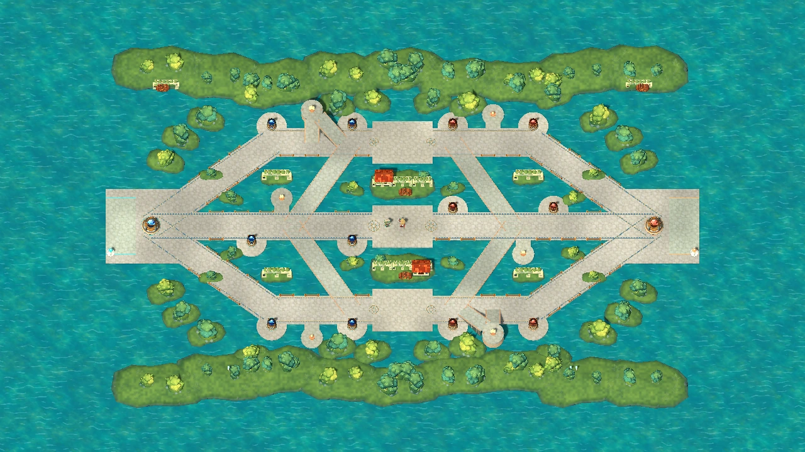

# 07. 아트 방향 — V5 수로 전장

- 기준일: 2026-11-05.
- 현재 목표: **3등신의 귀여운 세미카툰 판타지 영웅이 밝은 수로 공방에서 싸우는 PC AOS**.
- 실행 자산·편집·재현은 [25 V5 안내](25-illustrated-canal.md), 실제 수행 결과는 [최신 검증](verification/2026-11-05-v5-verification.md)을 따른다.

## 1. 화면이 전달해야 할 것

세 라인과 연결 통로, 병력의 전진 방향, 공격 가능한 적, 위험한 스킬 범위가 먼저 읽혀야 한다. 큰 머리와 간결한 의상, 무기와 색의 차이로 영웅을 알아보고, 이동·선딜·타격·회복 동작으로 행동을 구분한다. 작은 얼굴 무늬나 건물 장식이 전투 정보보다 강하게 보이면 장식의 대비와 밀도를 줄인다.

V5의 석재·물·공방 건물은 이 공간을 설명하는 실제 실행 자산이다. 과거의 생성 콘셉트 이미지는 제작 의도를 보여 주는 이력이며, 구현 증거는 실제 Godot 렌더로 구분한다.

## 2. 세계와 재질

수로와 경사로를 오가며 공동 작업장을 지키는 작은 판타지 길드의 시험 전장으로 읽히게 한다. 도자기와 회벽의 밝은 면, 구리와 목재의 따뜻한 부분, 청록 물, 테라코타 지붕과 짙은 잎을 사용한다. 과도한 실사 질감과 작은 노이즈는 피하고 큰 색면·모서리·그림자로 형태를 설명한다.

| 요소 | 현재 표현 | 제작 기준 |
|---|---|---|
| 이동 바닥 | 밝은 석재 타일과 길드 모자이크 | 라인·교차로·경사로의 연결이 끊겨 보이지 않게 한다 |
| 수로·비이동 영역 | 수로 바닥 텍스처와 표면 셰이더 | 건널 수 있는 길과 물의 경계를 명확히 한다 |
| 건물·외곽 | 관측소, 문루, 회랑, 부두 난간, 물레방아 | 병력·영웅과 교전 표시를 가리지 않는다 |
| 식생 | 정원 둑, 버드나무, 무화과나무 | 전투 중심부보다 낮은 정보 밀도를 유지한다 |
| 포탑·핵·셀 | 왕관·수정·관측소와 기존 목적물 표시 | 장식과 상호작용 가능한 목표가 구분되어야 한다 |
| 영웅 | 얼굴·의상 텍스처가 포함된 3종 GLB | 귀여운 비율과 팀 구별, 무기 실루엣을 함께 유지한다 |

환경 모델 11종과 표면 자산의 정확한 목록은 [V5 자산 표](25-illustrated-canal.md#2-복구된-실행-자산)에 있다. 장식은 기존 맵 판정 위에 배치하며 장식 모델 자체로 새 충돌·경로·시야 규칙을 만들지 않는다.

## 3. 캐릭터 방향

| 영웅 | 실루엣과 성격 | 전투에서 유지할 차이 |
|---|---|---|
| 바스 | 금발·진홍 의상·큰 룬 건틀릿, 낮고 넓은 무게감 | 근접 압박, 묵직한 준비·타격·반동 |
| 리오 | 연보라 머리와 마법사 모자, 천 장식과 쌍원반 | 원거리 궤적, 빠른 발놀림과 던지고 되받는 리듬 |
| 네마 | 초록 머리·자연 문양 의상·후드와 룬핀 배낭 | 핀·설치물의 위치와 설치·회수·시전 동작 |

얼굴은 읽기 쉬운 큰 눈과 단순한 명암, 의상은 큰 색면을 중심으로 한다. 얼굴·의상 WebP와 GLB 내부 텍스처는 별도 파일이므로 하나를 수정하면 다른 쪽도 맞춰 다시 내보내야 한다. 세부 외형과 스킬별 의도는 [캐릭터 기획](characters/README.md)을 따른다.

현재 실행판은 영웅당 10개 클립을 `AnimationPlayer`에 구성하고 머리·몸통·팔·다리의 노드 관절을 움직인다. 이동, 기본 공격, Q/W/E/R, 피격, 사망, 부활과 대기 동작이 있으며, 무릎·팔꿈치·의상 보조 동작을 더한다. 스킨과 본으로 구성된 완성형 캐릭터 제작 파이프라인을 확보했다는 뜻은 아니다. 관절 구조와 수정 계약은 [V5 동작 설명](25-illustrated-canal.md#3-실제-3d-관절-애니메이션)을 따른다.

## 4. 전장 가독성

우선순위는 **위험 범위·체력·상태·포탑 공격 정보 → 유닛·교차로·목적물 → 장식** 순서다. 화면을 축소해도 팀과 영웅 역할이 구분되어야 하며, 영웅 얼굴을 잘 보여 주기 위한 확대 구도가 기본 전투 카메라의 시야를 대신해서는 안 된다.

- 경고 범위와 벽·고지 경계는 전투 상태의 판정에 맞춘다.
- 장식은 라인, 연결 통로, 고지 진입부, 목표 선택을 가리지 않도록 배치한다.
- 몸통·팀 표시와 바닥 표시를 함께 사용해 의상 색 하나에만 팀 구별을 맡기지 않는다.
- 숨어 있는 적의 위치·스킬·피격 정보가 장식 이펙트, 초상화, 음향으로 새지 않게 한다.
- 피격 반동·발광·바닥 효과는 선딜·회복 시간과 조준 정보를 덮지 않도록 한다.

## 5. HUD·이펙트·음향

영웅 선택 카드는 바스·리오·네마 WebP 초상화를 사용한다. 경기 HUD는 Q/W/E/R 아이콘 12개와 전투 상태를 표시하며, 검토실은 실제 3D 모델과 스킬을 보여 준다. 각 스킬의 궤적·범위·충돌·종료 효과가 해당 영웅의 동작과 함께 읽히도록 한다. 공격·시전·피격·성장에 사용하는 WAV 5개가 이미 연결되어 있다. 출시 품질의 사운드 믹스, 사용자 환경의 음량·피로도 확인은 후속 작업이다.

## 6. 구현과 다음 제작을 구분한다

**구현됨:** 영웅 GLB 3종, 얼굴·의상 WebP 6개, 초상화 WebP 3개, 환경 GLB 11종, 수로 텍스처와 셰이더, 관절 동작, 스킬 효과와 전투 음향, 독립 검토실.

**다음 제작:** 사람의 실제 플레이에서 영웅 크기·스킬 겹침·고지 진입·미니맵을 평가하고, 관절 변형과 발 접지·의상 움직임을 다듬는다. 전장 장식의 드로콜과 실기 성능을 측정한 뒤 메시·재질 공유와 배치를 최적화한다. 모델 원본 생성기와 편집 가능한 제작 프로젝트의 회수 또는 대체 제작 절차도 남아 있다.

초기 공방 콘셉트, [V3 명세](21-fantasy-v3-art-spec.md), [V4 전투 표현](23-fantasy-v4-combat-presentation.md)은 단계별 기록으로 보존한다. 최신 미술 판단은 이 문서와 V5 실제 화면을 기준으로 하되, 게임 규칙 변경은 별도의 전투 설계 검토를 거친다.
