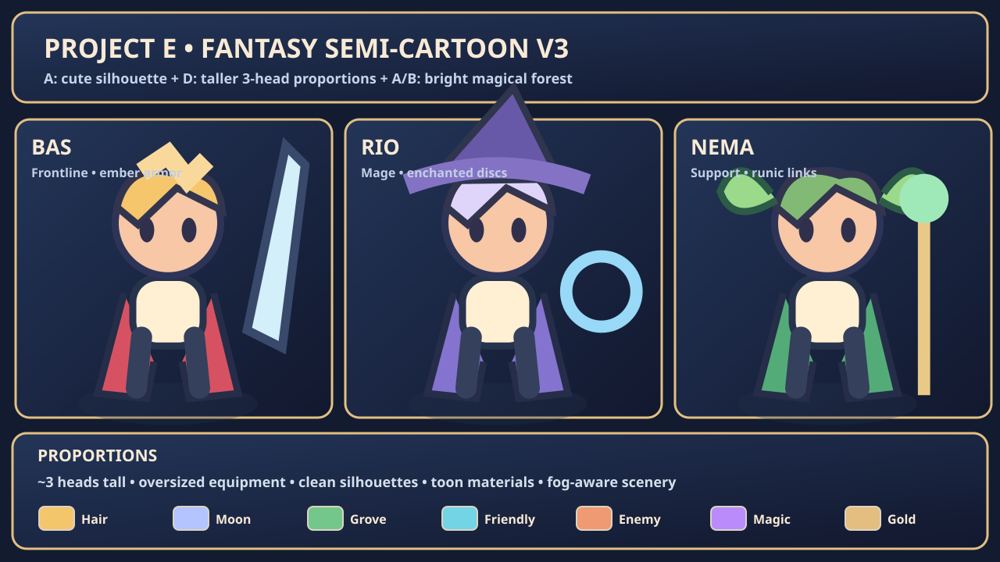
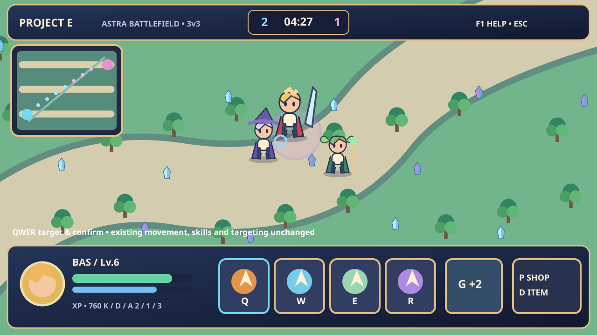
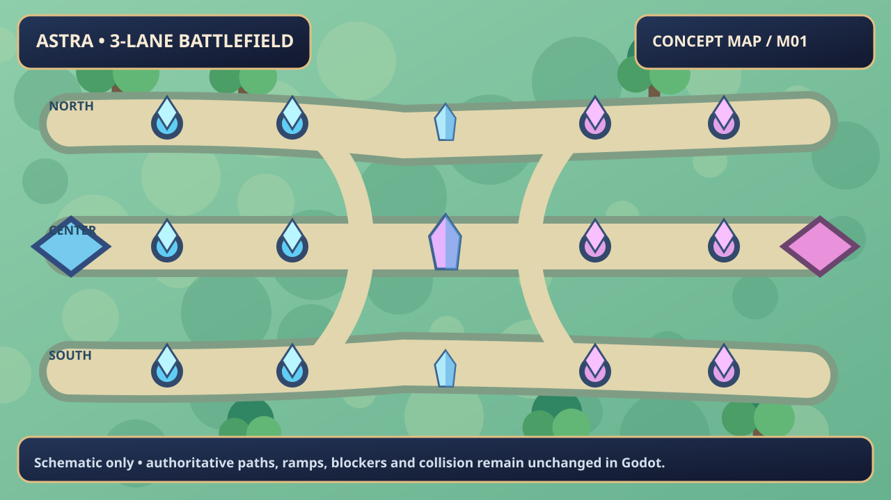
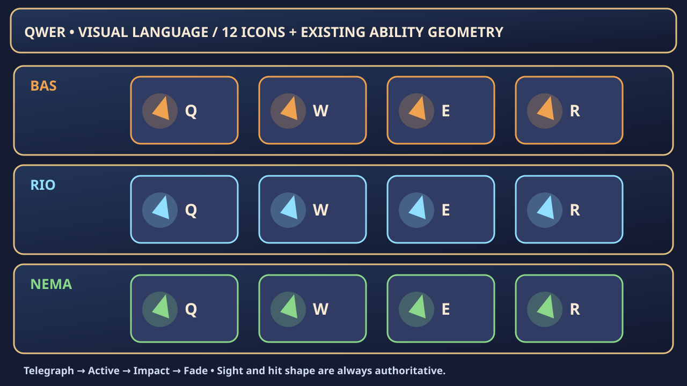

# 판타지 V3 에셋 / 게임 연결 가이드

## 적용 완료의 기준
게임은 기존 Godot 4.7.2 3D. **이 문서의 SVG는 콘셉트 시안**이며, 이미지 한 장을 잘라 붙인 실행 증거가 아니다. 실제 캐릭터는 `hero_rig.gd`의 3D 메시, 전장 장식은 `workshop_arena.gd`, UI는 `battle_hud.gd`에서 읽는다.

- 인게임 영웅 3종(바스/리오/네마)은 **머리 지름 약 0.88m, 전신 높이 약 2.7m → 약 3등신**의 비주얼 목표. 외형은 서로 다른 색·모자·머리·망토·장비를 사용한다.
- 선택 초상 3개: `game/project-e/assets/portraits/{bas,rio,nema}.svg`. 선택 화면의 `hero_portrait.gd`에서 읽는다.
- QWER 아이콘 12개: `game/project-e/assets/ui/skills/{bas,rio,nema}_{q,w,e,r}.svg`. 실제 전투 HUD에서 현재 영웅별로 바뀌며 스킬 명칭/코스트/재사용 시간은 기존 게임 로직이 제공한다.
- 맵 장식: 전장 장식만 나무, 푸른 수정, 밝은 석재·정원으로 치환. 기존 시야와 충돌 권한은 변경하지 않는다.
- 효과: QWER 12개는 기존 `skill_vfx.gd` / `effects_view.gd`의 실제 효과 영역 렌더를 사용한다. 이번 SVG는 HUD 식별용이다.

## 파일 형식·용량
- SVG는 압축이 아니라 텍스트 벡터라 3장 초상+12장 아이콘 합계 17KB 내외, 목업 4장도 소형 파일이다.
- 원본 PSD, 스프라이트 시트(걷기·공격 8방향), 사운드, 고해상도 원화는 현재 별도 생산 필요. **이번 단계에서 게임 작동을 위해 필요하지 않은 대용량 이미지는 Git에 넣지 않음.**
- Godot에서 `res://assets/...` 아래 SVG를 자동 임포트해서 `Texture2D`로 사용. 사용자가 첫 실행 전 프로젝트 import를 완료해야 한다.

## 원본/라이선스
이번 SVG와 엔진 기본 메시 장식은 이 프로젝트를 위해 직접 작성한 신규 자산이며 외부 에셋 라이브러리를 혼합하지 않았다. 상업용 프로젝트에서 편집·사용 가능. 다만 향후 추가 AI 생성 원화, 무료 애셋 또는 폰트를 편입할 때는 해당 라이선스를 각각 점검한다.

## F7 검토 순서
1. F7 통합 연출실: 바스/리오/네마 전신 3등신 비율, 모자·무기 실루엣, 대기·걷기·QWER·피격·사망.
2. 전투 30m vs 근접 18m 카메라: 판정 마커와 캐릭터 구분, 텍스처의 찌그러짐 여부 확인.
3. 3라인/연결로/고지: 새 판타지 장식이 보행 불가 지역에만 있는지, 시야 밖 장식의 명암이 제대로 어두워지는지 확인.
4. 선택 화면: 세 초상. 3명의 경기 시작 후 QWER 아이콘 교체. 스킬 중 재사용 시간/에너지 부족/궁극기 잠금 UI 확인.

## 향후 미술 백로그
- 동일한 스타일로 8방향 전용 캐릭터 리깅 및 프레임 애니메이션 (현재는 3D 관절클립 기반)
- 전장 전체 PBR/셀 셰이딩/원경, 정밀한 나무·석재·수정의 저폴리 메시 제작
- 실제 전투 녹화 검토로 가독성 튜닝, 포탑/미니언 실루엣 상세화
- SFX·환경음·스킬 타격음, 다음 영웅의 아트 원칙 및 스타일 QA

원작을 참고한 것은 **교전 템포 및 조작감**이며 고유 아트/스킬/UI를 직접 복제하지 않는다.
