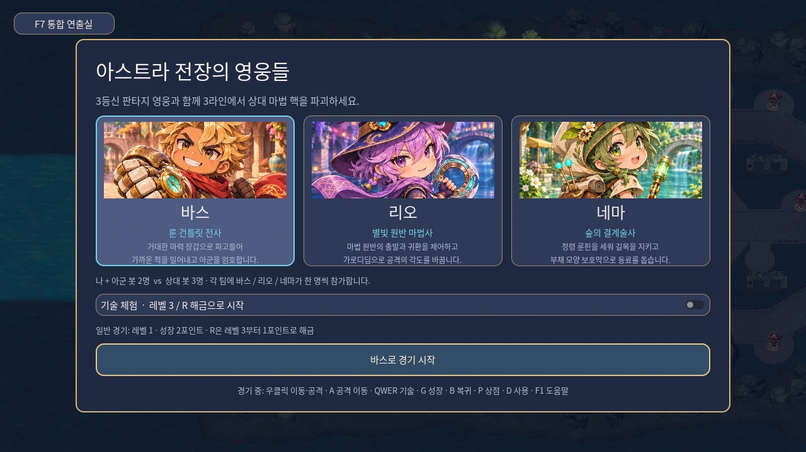
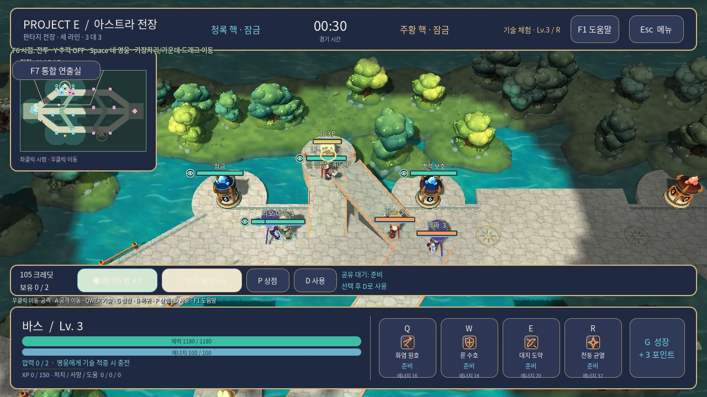
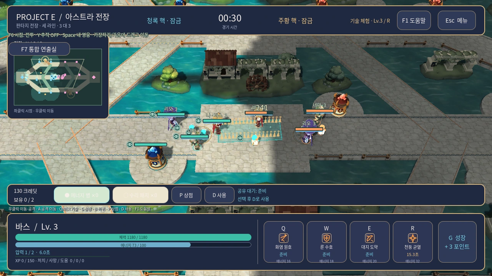

# 25. V5 — 3등신 영웅과 일러스트 수로 전장

- 기준일: 2026-11-05.
- 범위: 중단되었던 V5 실행 자산·표현 코드의 복구, 실제 게임·캐릭터 화면과 제작 계약 정리.
- 디자인 방향: **귀여운 3등신 세미카툰 판타지**, 밝은 수로 공방, 전투 정보 우선.
- 검증 기준: [이번 V5 검증 기록](verification/2026-11-05-v5-verification.md). Windows 사용자 PC 수동 플레이·온라인·Steam은 미완료다.

## 1. 이번 실행판에서 볼 수 있는 것

사람 1명과 봇 5명이 싸우는 오프라인 3 대 3을 바탕으로, 바스·리오·네마를 얼굴·의상 텍스처가 포함된 3D 모델로 표시한다. 기본 공격과 Q/W/E/R, 피격·사망·부활은 관절을 움직이는 실제 3D 동작이다. 수로 바닥과 수면, 석재 길, 관측소·회랑·문루·물레방아·식생을 전장에 배치했다. 영웅 선택 카드는 일러스트 초상화를, 경기 HUD는 상태·스킬 아이콘을 표시하며, 검토실에서는 실제 3D 모델을 확대해 본다.

### 실제 화면







| 보기 | 실제 렌더 |
|---|---|
| 바스 | [모델 보기](assets/v5/bas.webp) |
| 리오 | [모델 보기](assets/v5/rio.webp) |
| 네마 | [모델 보기](assets/v5/nema.webp) |
| 전장 | [전체 지도](assets/v5/map.webp), [라인 상세](assets/v5/lane.webp) |
| 교전 상세 | [중앙 교전 확대](assets/v5/mid-detail.webp) |
| 스킬 동작 | [12개 스킬 검토 영상](assets/v5/skill-review.mp4) |

위 WebP 9장은 실제 Godot 렌더러의 1280×720 화면이다. 경기 장면은 촬영 스크립트가 영웅·병력·카메라를 배치하고, 영웅·지도 보기는 독립 검토실을 사용한다. 사람의 자연 플레이 기록이나 Windows 사용자 PC 검증을 의미하지 않는다. 엔진·렌더러·소스 및 이미지 해시는 [capture-manifest.json](assets/v5/capture-manifest.json)에 있다. 이번 촬영 환경은 Godot 4.7.2의 OpenGL Compatibility와 Mesa llvmpipe다. 스킬 검토의 촬영·프레임·영상 정보는 [검증 기록](verification/2026-11-05-v5-verification.md)을 따른다.

## 2. 복구된 실행 자산

경로 기준은 `game/project-e/assets/`다. 아래 항목은 현재 실행 자산이며, 원본 제작 도구를 모두 회수했다는 뜻은 아니다.

| 분류 | 파일 | 용도 |
|---|---|---|
| 영웅 모델 3개 | `heroes/bas.glb`, `rio.glb`, `nema.glb` | 얼굴·의상 텍스처와 관절 노드를 포함한 현재 3D 모델 |
| 얼굴 텍스처 3개 | `heroes/bas-face.webp`, `rio-face.webp`, `nema-face.webp` | 영웅별 얼굴 편집용 이미지 |
| 의상 텍스처 3개 | `heroes/bas-tunic.webp`, `rio-tunic.webp`, `nema-tunic.webp` | 영웅별 의상 편집용 이미지 |
| 영웅 셰이더 | `heroes/painted.gdshader` | 텍스처와 색면을 사용하는 현재 모델 표현 |
| 초상화 3개 | `portraits/bas.webp`, `rio.webp`, `nema.webp` | 영웅 선택 카드 표시 |
| 바닥·수로 | `environment/canal_flagstones.webp`, `canal_waterbed.webp` | 석재와 수로 바닥 |
| 표면 셰이더 | `environment/canal_surface.gdshader` | 전장 표면과 시야 표시의 연결 |
| 스킬 아이콘 | `ui/skills/`의 기존 SVG 12개 | 3영웅 Q/W/E/R의 HUD 표시 |

환경 모델은 다음 11개다.

| 파일 | 표현 역할 |
|---|---|
| `environment/core_observatory.glb` | 핵의 관측소 형태 |
| `environment/terracotta_gatehouse.glb` | 테라코타 문루 |
| `environment/garden_bank.glb` | 정원 둑과 경계 |
| `environment/jade_willow.glb` | 청록 계열 버드나무 |
| `environment/sentinel_crown.glb` | 포탑 왕관 형태 |
| `environment/crown_crystal.glb` | 포탑·핵의 수정 |
| `environment/copper_millwheel.glb` | 회전하는 구리 물레방아 |
| `environment/ivy_cloister.glb` | 덩굴 회랑과 외곽 구조 |
| `environment/quay_rail.glb` | 부두 난간 |
| `environment/amber_fig.glb` | 따뜻한 색의 무화과나무 |
| `environment/guild_mosaic.glb` | 길드 모자이크 바닥 |

현재 WebP 초상화와 기존 V3 SVG 초상화는 구분한다. SVG 초상화와 이전 시안은 이력 자료로 보존하며, 파일이 남아 있다는 이유로 현행 HUD가 그것을 사용한다고 설명하지 않는다. 자산 제작자·외부 출처·라이선스는 확인된 기록 없이 새로 단정하지 않는다.

## 3. 실제 3D 관절 애니메이션

[hero_rig.gd](../../game/project-e/scripts/presentation/hero_rig.gd)는 GLB를 불러오고 이름이 있는 노드 관절을 구성한 뒤 `AnimationPlayer` 클립을 코드로 만든다. GLB에 완성된 애니메이션이 들어 있거나 `Skeleton3D`의 스킨 애니메이션으로 제작되었다고 설명하지 않는다.

| 동작 | 영웅당 클립 | 화면에서 하는 일 |
|---|---:|---|
| 대기·이동 | 2 | 호흡, 몸통과 팔다리 보행, 무릎·팔꿈치 보조 동작 |
| 기본 공격 | 1 | 준비·타격·회복의 팔·몸통 동작 |
| Q/W/E/R | 4 | 영웅과 스킬별 시전·이동·타격 자세 |
| 피격 | 1 | 짧은 반동 |
| 사망·부활 | 2 | 쓰러짐과 복귀 |
| 합계 | **10** | 3영웅 총 30개 클립, 이 중 영웅별 Q/W/E/R은 총 12개 |

`Torso`, `Head`, 좌우 팔·다리와 무기 노드가 동작하며, 의상 패널과 관절 보조 변형이 추가된다. 실제 우선순위는 사망·부활, 스킬, 기본 공격, 피격, 이동, 대기 순서의 상태를 바탕으로 선택한다. 전투 상태의 선딜·회복·이동 진행에 맞춰 클립을 재생·탐색하므로 애니메이션 길이가 공격 판정의 권한을 갖지 않는다.

피해량·사거리·투사체·경고·시야·충돌·재사용 대기시간은 [battle](../../game/project-e/scripts/battle/)의 상태와 규칙에서 정한다. 표현 계층은 이를 읽는다. 수정할 때 준비 자세를 더 오래 보여 주고 싶다면 표현의 단계 배분과 전투 시간의 변경을 구분해서 검토해야 한다.

## 4. 전장과 UI의 연결

| 소스 | 책임 |
|---|---|
| [workshop_arena.gd](../../game/project-e/scripts/presentation/workshop_arena.gd) | GLB 환경 장식, 목적물 외형, 식생·물레방아 등 전장 구성 |
| [arena_view.gd](../../game/project-e/scripts/presentation/arena_view.gd) | 바닥·수로 재질과 기본 전장 표시 |
| [terrain_relief.gd](../../game/project-e/scripts/presentation/terrain_relief.gd) | 맵 상태에 맞춘 높이 표현 |
| [hero_rig.gd](../../game/project-e/scripts/presentation/hero_rig.gd) | 3D 모델·재질·관절 동작 |
| [hero_portrait.gd](../../game/project-e/scripts/presentation/hero_portrait.gd) | 현재 WebP 초상화 표시 |
| [battle_hud.gd](../../game/project-e/scripts/presentation/battle_hud.gd) | 경기 HUD와 상태 정보 |
| [review_lab.gd](../../game/project-e/scripts/presentation/review_lab.gd) | 별도 상태의 영웅·스킬·전장 검토 |
| [fantasy_audio.gd](../../game/project-e/scripts/presentation/fantasy_audio.gd) | 전투 피드백 음향 |

환경 장식은 기존 맵의 이동 가능 영역과 목적물을 기준으로 배치한다. 장식 메시가 새로운 충돌·경로·시야 판정을 만드는 구조가 아니다. 고지와 경사로는 같은 맵 상태를 이동·시야·표시가 함께 읽는다. 화려한 물·모자이크·식생이 경고나 라인·경사로 진입을 가리지 않는지 실제 전투 카메라에서 확인한다.

## 5. 모델과 텍스처 수정 계약

복구된 최종 GLB는 현재의 편집 기준이다. 최종 영웅에는 17개 노드와 `Trappings`, `SwingPanel`, 내장 얼굴·의상 텍스처가 있다. 별도로 발견된 이전 생성기는 15개 노드의 텍스처 없는 이전 모델을 생성하므로 현재 모델을 정확히 재현하는 도구로 사용하지 않는다. **최종 V5 모델의 전체 생성 파이프라인은 아직 회수되지 않았다.**

1. 현재 GLB와 해당 WebP를 함께 보존하고 Blender 또는 glTF 편집 도구에서 GLB를 연다.
2. `hero_rig.gd`가 참조하는 이름·피벗·계층·기준 방향을 유지한다. 특히 `Torso/TeamMark`, `Torso/SwingPanel`, `LeftLeg/Shin`, `RightLeg/RightShin`, `LeftArm/LeftWeapon`, `RightArm/WeaponDetail` 경로와 `Head` 등 상위 관절 이름을 보존한다. 모델의 `Trappings` 등 나머지 노드도 임의로 삭제하지 않는다.
3. GLB에는 얼굴·의상 이미지의 JPEG 사본이 내장되어 있다. 바깥의 WebP만 바꾸어도 GLB 내부 이미지가 자동으로 교체되지는 않는다. 이미지 수정 후 내장 재질도 갱신해 GLB를 다시 내보낸다.
4. Godot에서 새 파일을 가져온 뒤 F7에서 대기·이동·기본 공격·Q/W/E/R·피격·사망·부활을 확인한다. 팔·무기·무릎·의상 연결과 팀 색도 확인한다.
5. 실제 경기 카메라에서 크기·목표 선택·경고 가림을 확인하고 자동 검사와 촬영을 다시 실행한다.

현재 원본의 제작 도구·입력 이미지·프롬프트·라이선스 등 확인되지 않은 출처를 추정해서 기록하지 않는다. 편집 가능한 제작 프로젝트와 정확한 생성 절차를 회수하거나 새로 정리하면 그 결과를 별도 제작 기록으로 추가한다.

## 6. 재현과 확인

저장소 루트에서 Godot 4.7.2 Standard 실행 파일을 지정한다.

```sh
python tools/check_godot.py --godot /absolute/path/to/godot
python tools/check_art_assets.py
python tools/check_audio_assets.py
python -m unittest discover -s tools/tests -p 'test_package_windows.py'
```

9장 구성 촬영은 [capture_illustrated_pass.gd](../../tools/art/capture_illustrated_pass.gd)가 담당한다. 아래는 실제 화면 렌더가 가능한 환경에서 실행하는 예다.

```sh
mkdir -p /tmp/project-e-v5-captures
/absolute/path/to/godot --path game/project-e \
  --rendering-method gl_compatibility --audio-driver Dummy \
  --script "$PWD/tools/art/capture_illustrated_pass.gd" \
  -- --output=/tmp/project-e-v5-captures
```

Linux의 화면 없는 실행 환경에서는 사용 가능한 가상 디스플레이를 별도로 구성해야 한다. 이 촬영을 화면을 만들지 않는 headless 검사와 혼동하지 않는다. 스크립트는 PNG를 출력하고, 저장소의 WebP는 전달용 변환본이다. `--video`는 추가 동작 프레임을 저장하는 옵션이며 MP4를 자동 인코딩한다는 뜻은 아니다. 파일 형식을 바꾼 뒤에는 이미지 크기·누락과 검증 목록을 다시 확인한다.

촬영을 재현할 수 있다는 사실과 원본 모델 생성기를 재현할 수 있다는 사실은 다르다. 현재는 저장된 GLB·텍스처·코드로 실행 화면을 재현할 수 있으며, 전체 모델 제작 절차에는 위의 회수 제한이 남아 있다.

## 7. 검증의 범위와 다음 작업

최신 [검증 기록](verification/2026-11-05-v5-verification.md)은 새 가져오기와 시작 장면, 전투 회귀 검사, 자산·배포 검사, 9장 실제 렌더와 스킬 검토 촬영의 수행 결과를 분리한다. 과거 V2·V3·V4 문서의 검사 개수를 이번 통과 수치로 옮겨 쓰지 않는다. 소프트웨어 렌더러에서 얻은 화면 통계는 대상 Windows PC의 FPS 증거가 아니다.

다음 단계는 사용자 PC의 실제 입력 플레이, 6영웅 교전 가독성과 고지 회전의 확인, 모델 관절·발 접지·음향 피로도 개선, 실기 성능 측정이다. 온라인·재접속·Steam과 모델 제작 원본 확보도 남아 있다. 우선순위와 완료 조건은 [남은 개발](11-remaining-development.md)에 정리한다.
