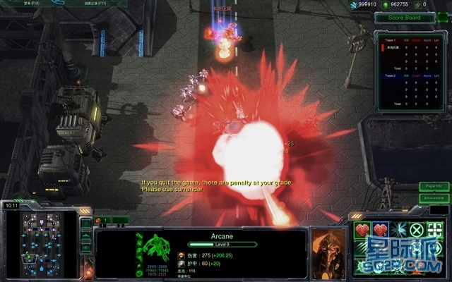
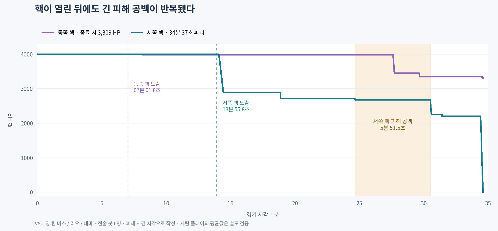

# 원작 맵·미니언·공성 재검토

2026-11-10에 V8의 실행 코드와 시티 오브 템페스트의 시각 자료를 대조했다. 검사 기준은 `eb022135baf95046e1b1145bec45f5c26bab5b8a`, 게임 소스 트리는 `60f8258919678e4b5c4f3c554c16727122ba8772`다. 실행 엔진은 Godot `4.7.2.stable.official.ed1daf0bf`다.

## 확인 결과

1. 원작 자료의 진영은 상단과 하단에 있고, 좌·중·우 세 라인이 세로로 이어진다. 현재 M01의 서쪽·동쪽 진영은 이 배치를 반영하지 못했다.
2. 일반 미니언의 1 HP 유보는 원작의 마무리 기회를 남기는 규칙을 적용한 결정이다. 실제 격리 시험에서 여러 웨이브의 저체력 병력이 잔존하고, 공성병이 그 병력을 정리하는 현상이 확인됐다.
3. 기본 전술 봇 경기는 34분 37.3초에 끝났다. 실제 파괴된 핵은 13분 55.8초에 노출됐으므로, 그 핵의 노출부터 파괴까지 20분 41.6초가 걸렸다. 긴 구간의 상당 부분은 구조물 공격이 끊긴 시간이다.

## 원작 영상과 맵에서 관찰한 것

지정 영상의 길이는 23분 37초다. 약 10초 간격의 실제 스토리보드 143개 프레임을 검토했다. 원본 표본은 160×90이며, 영상 CDN이 `Site Unavailable` HTML을 반환해 고해상도 연속 재생은 확보하지 못했다. 다음 시각은 표본의 근사 위치다. [지정 영상](https://www.youtube.com/watch?v=B0V1yRqhIc8)

| 영상 구간 | 직접 관찰한 화면 | 설계에 반영할 관계 |
|---|---|---|
| 약 00분~03분 | 진영에서 위쪽으로 이어지는 길, 큰 지형 사이 세로 도로의 교전 | 상하 진영과 세로 진행축 |
| 약 05분 10초~05분 40초, 10분~10분 30초 | 사각 차폐 지형 옆의 길과 꺾이는 교차부 | 라인 사이 우회·지원 통로 |
| 약 03분 40초, 06분, 12분, 15분, 22분 10초 | 진영 입구나 거점 주변이 반복해서 등장 | 전선과 기지 주변을 오가는 경기 흐름 |
| 약 22분 40초~녹화 말미 | 거점 입구 주변의 다수 유닛 교전과 종료 UI | 최후방 진입과 마지막 교전 공간 |

개체 이름, HP, 공격 간격, 정확한 파괴 순서는 이 해상도로 읽기 어렵다. 영상 길이에는 녹화·재생 조건이 포함되므로 원작의 평균 경기 시간으로 사용하지 않는다.

2011-06-22의 영어판 v1.3 배포 페이지에 첨부된 게임 스크린샷에서는 미니맵의 상단 보라색 진영과 하단 청록색 진영, 세로 세 통로와 가로 연결부를 확인했다. 지정 한국어 영상과 시기·버전이 다른 보조 시각 자료다. [배포 페이지](https://games.sina.com.cn/d/m/pc/133247.shtml) · [원본 스크린샷](https://i1.sinaimg.cn/gm/cr/2011/0622/2531619812.jpg)

원본 이미지와 지정 영상의 정지 표본을 근거 모음에 보존했다. [시각 근거 모음](assets/cot-audit-20261110/README.md)

### M01 수정 명세

| 항목 | V8 현재 구현 | 후속 맵 수정 기준 |
|---|---|---|
| 진영 축 | 서쪽 핵 `(−50,0)`, 동쪽 핵 `(50,0)` | 상단·하단 진영으로 배치 |
| 라인 호칭 | 북쪽·중앙·남쪽 | 왼쪽·중앙·오른쪽으로 통일 |
| 기본 형태 | 가로 100~112 m 라인, 네 대각 연결로 | 세로 진행축과 인접 라인 사이 연결 관계를 먼저 설계 |
| 차폐 지형 | 라인 사이 사각 차단체와 작은 고지 발판 | 화면에서 우회와 합류 지점을 읽을 수 있는 큰 지형 덩어리로 구성 |
| 기지 진입 | 세 라인이 핵 주변으로 합류 | 진입부, 후방 방어 지점, 최종 거점 주변의 싸울 공간을 함께 구성 |
| 카메라·미니맵 | 현재 가로형 전장 기준 | 상하 전진, 좌우 지원, 화면 가장자리 이동과 미니맵 클릭을 같은 방향으로 검증 |

수정 시 좌표 변환과 함께 라인 이름, 부활 방향, 카메라 경계, 미니맵, 길찾기, 포탑 위험 구간을 검사한다. 원작의 정확한 거리와 구조물 수는 후속 판독이 필요하다. 판타지 수로 전장에서는 원작의 통로·차폐·거점 관계를 성벽, 수로, 폐허와 경사로에 대응시킨다. [현재 맵 명세](content/02-map-and-vision.md) · [맵 권한 소스](../../game/project-e/scripts/battle/battle_map.gd)

## 미니언 수치와 실제 동작

첫 웨이브는 20초, 이후 간격은 18초다. 라인당 근접 3기와 원거리 1기가 나오며 매 네 번째 웨이브에 공성병 1기가 추가된다. 첫 공성병은 74초, 이후 공성병 간격은 72초다.

| 종류 | 초기 HP | 1회 피해 | 공격 간격 | 사거리 | 초기 이론 DPS |
|---|---:|---:|---:|---:|---:|
| 근접 | 240 | 20 | 1초 | 1.5 m | 20 |
| 원거리 | 180 | 25 | 1.2초 | 6 m | 20.83 |
| 공성 | 480 | 45 | 1.5초 | 7.5 m | 30 |
| 포탑 | 외곽 2,000 / 내곽 2,600 | 180 | 1초 | 8.5 m | 180 |

이론 DPS는 계속 공격할 수 있는 정지 표적 조건의 계산값이다. 새로 생성되는 미니언의 HP·피해는 기본값 기준 4·8·12분에 각각 +10·+20·+30% 배율을 받는다. 실제 첫 해당 웨이브는 254·488·722초다. 기존 병력에는 소급하지 않으며 이동속도, 공격 간격, 보상은 이 배율로 증가하지 않는다. [병력 생성 코드](../../game/project-e/scripts/battle/battle_state.gd)

### 마무리 유보와 병력 잔존

근접·원거리 미니언은 적 영웅·병력·구조물을 1 HP까지 공격한다. 표적의 HP가 1 이하이고 보호막이 없으면 그 표적을 해제하고 전진하거나 다른 적을 찾는다. 공성병·영웅·포탑은 처치를 마무리할 수 있다. 원작 PDF는 약 30 HP 또는 일정 비율에서 공격을 중단하는 설명을 담고 있으며, 현재 1 HP는 Project E의 적용 수치다. [V6 적용 기록](26-cot-reference-v6.md) · [피해 판정](../../game/project-e/scripts/battle/battle_rules.gd) · [병력 AI](../../game/project-e/scripts/battle/battle_ai.gd)

영웅과 포탑을 제거한 중앙 라인에서 실제 생성 주기와 전투 로직을 사용해 다섯 웨이브를 관찰했다. 표의 시각은 다음 웨이브 생성 직전의 표본 경계다.

| 경기 시각 | 누적 생성 | 생존 | 1 HP 생존 | 생존 공성병 | 누적 사망 |
|---|---:|---:|---:|---:|---:|
| 38초 | 8 | 8 | 2 | 0 | 0 |
| 56초 | 16 | 16 | 12 | 0 | 0 |
| 74초 | 24 | 24 | 24 | 0 | 0 |
| 92초 | 34 | 22 | 18 | 2 | 12 |
| 110초 | 42 | 10 | 4 | 2 | 32 |

1 HP 병력도 공격력, 시야와 구조물 보호 해제 자격을 유지한다. 여러 웨이브가 남는 현상이 재현됐으며, 뒤이어 온 공성병이 저체력 병력을 제거했다. 실제 경기에는 영웅과 포탑의 제거가 추가된다.

### 포탑까지 도착한 병력의 체력이 공성에 주는 영향

수비 영웅·병력이 없는 외곽탑에 동일한 초기 전열을 접근시켰다. 전열 선두는 `(0,0)`, 포탑은 `(10,3.5)`이며, 같은 이동·기본 공격·투사체 로직을 사용했다.

| 공격 웨이브 | 탑에 준 피해 | 접근 시작 후 전멸까지 |
|---|---:|---:|
| 초기 일반 웨이브 4기 | 205 | 7.2초 |
| 초기 공성 포함 5기, 모두 온전한 HP | 475 | 10.2초 |
| 일반 4기만 1 HP, 공성병은 온전한 HP | 230 | 7.2초 |
| +30% 공성 포함 5기, 모두 온전한 HP | 708.5 | 12.2초 |

같은 공성 포함 웨이브라도 일반 병력의 HP를 1로 바꾸면 탑 피해가 약 51.6% 줄었다. 공성 지원을 살아 있는 병력 한 기의 존재만으로 판단하면, 실제로 포탑을 버틸 시간을 충분히 반영하기 어렵다.

공성병의 포탑 대상 최대 중심 거리는 8.5 m, 포탑의 공성병 대상 최대 중심 거리는 8.95 m다. 공성병 신규 표적 탐색은 중심 8 m이며, 적 병력을 구조물보다 먼저 선택한다. 공성병이 라인 정리와 건물 공격을 함께 담당하는 현재 조건을 밸런스 조정에 반영해야 한다.

## 공성 단계 계측

양 팀 바스·리오·네마의 실제 전술 AI를 여섯 봇으로 실행했다. 플레이어 입력은 없으며, 외부 관찰기가 원래 피해 판정과 AI 함수를 호출한 뒤 기록했다. 30 Hz 내부 판정, 0.5초 외부 진행, 구조물 사건의 실제 시각과 0.5초 상태 표본을 사용했다. 기존 V8의 2,077.3초 종료, 3,651회 시전, 13회 영웅 사망이 재현됐다.

| 사건 | 경기 시각 | 해당 진영과 의미 |
|---|---:|---|
| 첫 구조물 피해 | 00분 36.7초 | 라인전 초반부터 구조물 피해 발생 |
| 첫 외곽탑 파괴 | 01분 51.1초 | 동쪽 북라인 외곽탑 |
| 첫 내곽탑 파괴·핵 노출 | 07분 01.8초 | 동쪽 핵이 먼저 노출 |
| 첫 핵 피해 | 08분 08.9초 | 동쪽 핵 |
| 서쪽 핵 노출 | 13분 55.8초 | 최종적으로 파괴되는 핵 |
| 서쪽 핵 첫 피해 | 14분 06.3초 | 승리팀의 핵 공성 피해 시작 |
| 서쪽 핵 파괴·동쪽 승리 | 34분 37.3초 | 자연 종료 |

먼저 핵이 노출된 동쪽이 최종 승리했다. 최종 파괴 대상인 서쪽 핵의 노출→파괴는 20분 41.6초이며, 첫 피해→파괴는 20분 31.0초다. 각 진영의 시각을 유지해 공격 흐름을 추적한다.

### 실제 파괴된 핵에서 확인한 지연

| 지표 | 서쪽 핵 관측값 |
|---|---:|
| 노출 상태에서 살아 있던 시간 | 약 1,241.5초 |
| 공격 측 병력이 중심 12 m 안에 있던 시간 | 약 187초, 노출 시간의 15.1% |
| 공격 측 영웅과 병력이 함께 12 m 안에 있던 시간 | 약 40.5초 |
| 영웅이 핵을 표적으로 둔 상태의 표본 합 | 약 7.5초 |
| 핵 피해 사건 사이 가장 긴 공백 | 약 351.5초, 5분 51.5초 |
| 1 HP로 남아 있던 표본 합 | 0초 |

상태 시간은 0.5초 표본 합이며, 실제 공격 판정의 모든 선딜·투사체·범위 타격 시간을 뜻하지 않는다. 핵의 피해 4,000 가운데 병력은 2,971.59, 영웅 리오는 1,028.41을 담당했다. 해당 경기에서는 핵이 1 HP에서 오랫동안 멈춰 있는 현상이 나타나지 않았다.

현재 영웅의 구조물 피해에는 0.5배가 적용되고, 주변 아군 병력 부재 시 추가 0.3배가 적용된다. 봇은 주변 병력이 없는 구조물을 신규 목표에서 제외한다. 공격 가능한 구조물 주변에서도 적 미니언과 가까운 적 영웅을 먼저 고른다. 이 정책과 병력의 짧은 생존이 공격 가능한 시간을 줄이는 원인 후보다. [전투 판정](../../game/project-e/scripts/battle/battle_rules.gd) · [기본 AI](../../game/project-e/scripts/battle/battle_ai.gd) · [전술 AI](../../game/project-e/scripts/battle/tactical_ai.gd)

## 단일 조건 비교

만렙 이후 경험치 셀을 새 목표로 고르는 조건 하나를 바꾼 외부 비교 시험을 수행했다. `_best_cell`에서 레벨 12 이상이면 빈 후보를 반환하고, 이미 진행 중인 임무는 기존 규칙으로 마무리한다. 팀 구성·전투 수치·입력 간격은 같았다. 첫 만렙 시각인 480.77초 이전의 사건 842개는 두 실행에서 완전히 일치했다.

| 지표 | V8 기본 조건 | 만렙 셀 신규 선택 제외 |
|---|---:|---:|
| 관찰 종료 시각 | 34분 37.3초, 자연 승리 | 40분 00.5초, 승패 미결정 |
| 서쪽 핵 잔여 HP | 0 | 2,533.82 |
| 동쪽 핵 잔여 HP | 3,309.38 | 2,900.71 |
| 파괴된 탑 | 10 | 11 |
| 누적 셀 임무 | 165 | 54 |
| 서쪽 핵 주변 영웅·지원 병력 동시 체류 | 약 40.5초 | 약 15.5초 |

대조 경기의 만렙 이후 새 셀 임무 시작은 0회로 조건이 적용됐다. 해당 경기에서는 기본 조건보다 최소 5분 23.2초 더 오래 진행됐으며, 실제 종료 시간은 관찰되지 않았다. 셀은 만렙에도 골드 10 공유 보상이 남고, 셀 선택 변경은 이동·전투·회복 순서도 바꾼다. 이 단일 조합에서는 만렙 셀 선택 차단의 공성 단축 효과가 확인되지 않았다.

기본 관측 상한은 3,000초였고 실제 2,077.3초에 종료했다. 대조의 명목 상한은 2,400초였으며 `time < limit`과 0.5초 진행의 부동소수점 경계 때문에 최종 표본이 2,400.5초다. 각 열의 누적 횟수와 체류 시간에는 서로 다른 관찰 길이가 포함된다.

## 다음 수정의 검증 기준

| 우선 항목 | 수정 가설 | 판정할 관측값 |
|---|---|---|
| 맵 방향과 동선 | 상하 진영·세로 세 라인에 기지 진입과 옆길을 함께 설계 | 진영별 이동, 라인 합류, 카메라·미니맵 방향, 구조물 주변 경로 |
| 공성병 역할 | 방어 병력 정리와 구조물 공격 사이의 우선순위를 조정 | 공성병의 구조물 도달 수·HP·대상별 피해·생존 시간 |
| 병력 동반 공격 | 저체력 병력의 짧은 생존과 곧 도착할 증원을 함께 판단 | 지원 병력 소멸로 끊긴 공격, 영웅의 무의미한 진입·후퇴 |
| 핵 마무리 판단 | 노출된 핵과 수비 병력의 위협을 비교하는 전술 판단을 추가 | 실제 파괴 핵의 노출→종료, 피해 공백, 무리한 진입 사망 |
| 후반 병력 압력 | 12분 이후의 강화 상한과 공성병 주기를 한 변수씩 비교 | 종료 시간, 역전 가능성, 영웅 부재 시 자동 공성의 비중 |

공성 길이는 핵 노출→파괴와 실제 공격 공백을 함께 측정한다. 첫 외곽탑은 2분 안에 파괴된 이번 결과를 기준으로, 후반 지연을 줄이는 조정이 초반 라인전까지 과도하게 단축하는지 확인한다. 여덟 영웅의 사람 플레이와 여러 조합의 반복 검증은 후속 밸런스 단계에 포함한다.

## 확인 범위와 재현

이번 확인은 기준 버전의 코드 감사, 일반 병력 회귀 50개, 추가 격리 검사 27개, 기본 조합 전술 봇 경기 계측을 포함한다. 격리 검사와 기존 회귀는 각각 실패 0개다. 전술 봇 단일 조합의 결과는 사람 대전의 평균과 별도로 기록한다.

실행용 관찰기, 검증 로그, 두 경기의 구조물별 결과를 함께 보존했다. [재현 방법과 결과 데이터](verification/cot-audit-20261110/README.md)

초기 문서의 미니언 마무리 허용, 보호 규칙 부재, 포탑 사거리 9 m 설명은 V6 이후의 실행 규칙과 충돌했다. 현재 기준은 일반 병력 1 HP 유보와 포탑 사거리 8.5 m다. [병력과 AI 상세](content/04-units-and-ai.md) · [게임허브](README.md)
