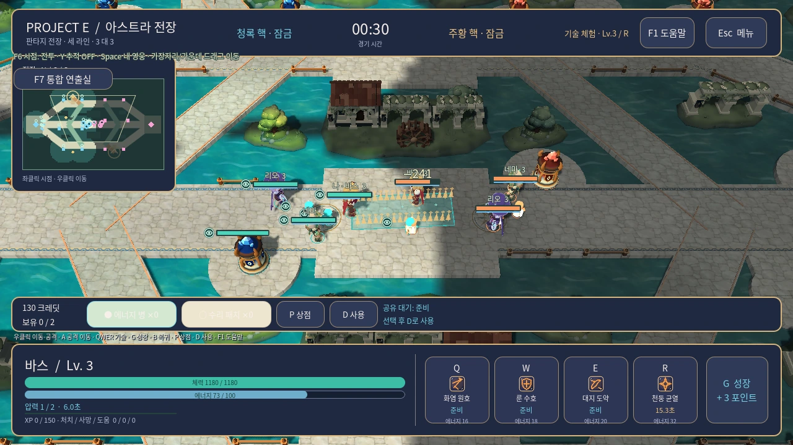

# 프로젝트 E 설계 문서

- 현재 기준은 **V7 판타지 스킬·아이템**, 2026-11-06이다.
- 실행판: Godot 독립 PC 게임, 오프라인 3 대 3, 사람 1명 + 봇 5명.
- 영웅: 바스·리오·네마. 최신 미술 방향: 3등신의 귀여운 세미카툰 판타지.

현재 구현은 저장소 안내와 V7 스킬·아이템 구성에서 확인한다. 수로 전장과 영웅 모델의 편집·재현은 V5 제작 안내를 참조한다. 요소별 전투 규칙은 아래 기획 문서와 실제 소스를 대조한다. [저장소 안내](../../README.md) · [V7 스킬·아이템](27-fantasy-skills-v7.md) · [V5 제작·재현](25-illustrated-canal.md)

이 화면은 실제 렌더러에서 구성한 검토 장면이다. 생성 시안과 구분하며, 촬영 조건은 [캡처 목록](assets/v5/capture-manifest.json)에 남긴다.

## 요소별 기획

| 문서 | 내용 |
|---|---|
| [01 경기 흐름](01-match-loop.md) | 경기 시작, 성장, 공성, 승패 |
| [02 M01 맵](02-map-m01.md) | 세 라인과 연결 통로, 구조물, 셀과 고지 |
| [03 전투](03-combat.md) | 기본 공격, 스킬, 피해·상태·시야 계약 |
| [04 유닛·AI](04-units-and-ai.md) | 병력, 봇 판단과 행동 범위 |
| [05 성장·경제](05-growth-and-economy.md) | XP, 포인트, 기지, 상점과 소모품 |
| [06 UI·조작](06-ui-and-controls.md) | 입력, 조준, HUD, 패널과 카메라 |
| [07 아트 방향](07-art-direction.md) | 현재 시각 목표와 읽기 우선순위 |
| [08 초기 로드맵](08-roadmap.md) | 초기 단계 계획의 이력 |
| [09 검증 매트릭스](09-verification.md) | 초기 검증 기준과 증거 연결 |
| [10 설계와 실행판의 차이](10-differences.md) | 확정한 차이, 근사와 미완료 범위 |
| [11 남은 개발](11-remaining-development.md) | 현재 구현 이후의 우선순위와 완료 조건 |
| [캐릭터 목차](characters/README.md) | [바스](characters/01-bas.md) · [리오](characters/02-rio.md) · [네마](characters/03-nema.md) |

## 현재 제작·검증 자료

| 문서 | 현재 역할 |
|---|---|
| [27 V7 판타지 스킬·아이템](27-fantasy-skills-v7.md) | 15개 스킬 이름, 12개 아이콘·효과, 정령목, 별샘 영약과 숲빛 치유약 |
| [2026-11-06 V7 검증](verification/2026-11-06-v7-verification.md) | 전체 회귀, 12개 스킬·두 아이템의 실제 PCK 화면, Windows 기동, 연출 성능 보정 |
| [2026-11-06 V6 검증](verification/2026-11-06-v6-verification.md) | 선택 화면, HUD, 추적·가장자리 카메라, PDF 전투 규칙 적용 |
| [25 V5 수로 전장](25-illustrated-canal.md) | 복구된 3D 모델·텍스처·환경, 관절 애니메이션, 수정·촬영 방법 |
| [2026-11-05 V5 검증](verification/2026-11-05-v5-verification.md) | 이번 소스에 대한 자동 검사, 렌더, 내보내기 수행 결과 |
| [V5 캡처 목록](assets/v5/README.md) | 실제 경기·영웅·전장 이미지와 검토 영상 |
| [게임 자산 안내](../../game/project-e/assets/README.md) | 실행 자산의 위치와 편집 주의점 |

현재는 세 라인·공성·성장·상점, 셀 보상과 시야, 고지와 네 진입 경사로, 봇의 관측 셀 수집·지원·핵 방어·복귀가 구현되어 있다. V5는 그 위에 얼굴·의상 텍스처를 가진 GLB 영웅 3종, 환경 GLB 11종, 수로 표면, 영웅 선택 초상화를 연결한다. 영웅당 10개 관절 동작과 Q/W/E/R 효과, 전투 음향도 실행판에 존재한다. ‘봇 미구현’, ‘음향 전체 미구현’, ‘현재 영웅은 임시 도형뿐’이라는 초기 단계의 표현을 현재 상태로 해석하지 않는다.

Windows 사용자 PC의 수동 플레이, 사람 간 밸런스, 하드웨어별 성능, 온라인·재접속·Steam은 아직 별도 작업이다. 최신 검증 문서는 실제 수행된 검사만 완료로 기록한다.

## 단계별 이력 — 삭제하지 않는 자료

| 단계 | 문서 |
|---|---|
| 초기 플레이·소모품 | [12 로컬 플레이 기록](12-local-playtest-record.md), [13 소모품 검증](13-consumables-verification.md) |
| 전장 재검토·고지 | [14 참조와 우선순위](14-tempest-reference-reprioritization.md), [15 고지 검증](15-high-ground-verification.md), [16 고지 동선](16-r30-high-ground-flow-verification.md) |
| 피드백·초기 시각 통합 | [17 XP 피드백](17-xp-feedback-verification.md), [18 플레이 가능한 시각 단계](18-playable-visual-slice.md) |
| V2 | [19 통합 실행판](19-integrated-v2.md), [20 전달 기록](20-v2-delivery.md) |
| V3 | [21 판타지 아트 명세](21-fantasy-v3-art-spec.md), [22 자산 가이드](22-fantasy-v3-asset-guide.md) |
| V4 | [23 전투 표현](23-fantasy-v4-combat-presentation.md), [24 자산 가이드](24-fantasy-v4-asset-guide.md) |

초기 공방 시안, V3 숲·석재·수정 테마와 V4 표현 검토는 의사결정의 이력이다. V5는 수로 공방의 공간 정체성에 최신 세미카툰 영웅을 연결한 현재 구현이다. 기존 `docs/`의 기술·배포·온라인 계획도 보존하지만, 계획을 구현 완료의 근거로 사용하지 않는다.

## 문서 유지 규칙

- **계획**은 목표와 완료 조건을 적고, **구현**은 실제 소스와 연결한다.
- **자동 검사**, **실제 렌더 확인**, **사용자 PC 수동 플레이**를 서로 대체하지 않는다.
- 생성 시안에는 시안임을 표시하고 실제 렌더에는 촬영 조건과 대상 소스를 기록한다.
- 캐릭터나 장식 수정이 전투 판정·시야·동선을 바꾸면 관련 전투 기획과 검증도 함께 갱신한다.
- 과거 검사 수치나 봇 경기 결과를 새 버전의 성능·밸런스 보증으로 옮겨 쓰지 않는다.
