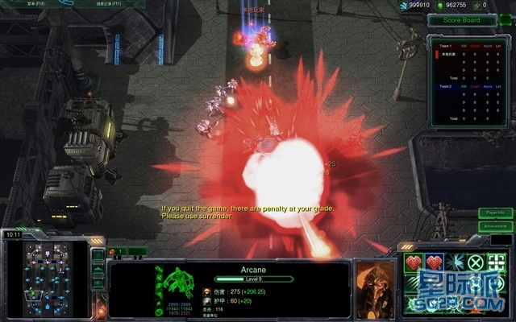
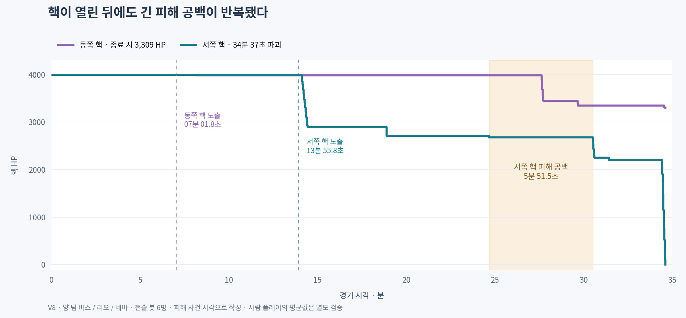

# 원작 맵 시각 근거와 공성 계측 그림

2026-11-10 검토에 사용한 원본 시각 표본과 실행 계측 그림이다. 해석과 측정 조건은 연결된 검토 문서에서 확인한다. [맵·미니언·공성 재검토](../../29-cot-map-minion-siege-review.md)

## 원작 게임 스크린샷

`sina-map.jpg`는 2011-06-22 영어판 City of Tempest v1.3 배포 페이지의 640×400 게임 스크린샷을 원본 바이트로 보존한 것이다. 좌하단 미니맵의 상하 진영과 세로 진행축을 확인했다. [배포 페이지](https://games.sina.com.cn/d/m/pc/133247.shtml) · [원본 이미지](https://i1.sinaimg.cn/gm/cr/2011/0622/2531619812.jpg)

## 지정 영상의 실제 정지 표본

랑죠 채널의 윤완진 플레이 영상에서 공개 스토리보드 143장을 확보했다. 각 표본은 160×90이고 약 10초 간격이며, 5열×5행 시트에 왼쪽 위부터 행 순서로 배열된다. 시트 0~4에는 각각 25장, 시트 5에는 마지막 18장이 있다. 마지막 표본은 녹화 말미에 해당한다. `video-metadata-summary.json`에 제목·게시일·길이·표본 규격을 보존했다. [지정 영상](https://www.youtube.com/watch?v=B0V1yRqhIc8)

| 원본 시트 | 근사 구간 |
|---|---|
| [0](storyboard-original-0.jpg) | 00분~04분 |
| [1](storyboard-original-1.jpg) | 04분 10초~08분 10초 |
| [2](storyboard-original-2.jpg) | 08분 20초~12분 20초 |
| [3](storyboard-original-3.jpg) | 12분 30초~16분 30초 |
| [4](storyboard-original-4.jpg) | 16분 40초~20분 40초 |
| [5](storyboard-original-5.jpg) | 20분 50초~녹화 말미 |

영상 CDN이 영상 대신 `Site Unavailable` HTML을 반환해 고해상도 연속 프레임을 확보하지 못했다. 이 표본으로 도로·큰 차폐 지형·진영 입구를 검토했으며, 세부 HP·공격 주기·구조물 이름과 정확한 파괴 시각은 판독 범위 밖이다.

## Project E 핵 HP 계측

`core-hp.png`는 V8의 바스·리오·네마 전술 봇 대전에서 실제 구조물 피해 사건으로 그린 계단 그래프다. 각 핵의 노출 시각을 세로선으로, 서쪽 핵의 가장 긴 피해 사건 사이 공백을 음영으로 표시했다. [계측 조건과 결과](../../29-cot-map-minion-siege-review.md#공성-단계-계측)

