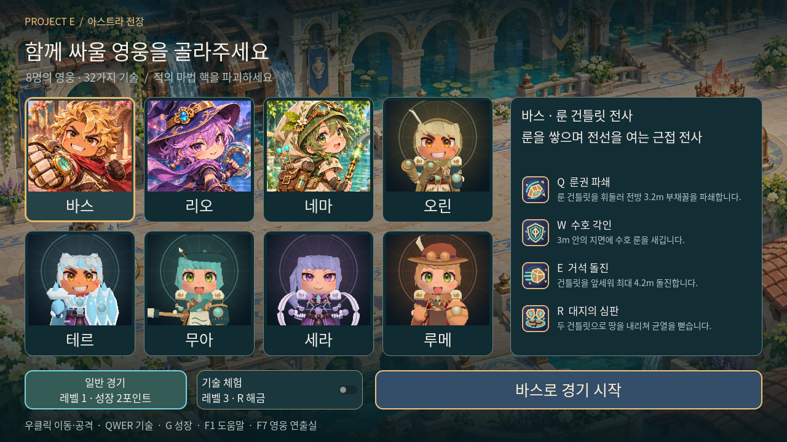
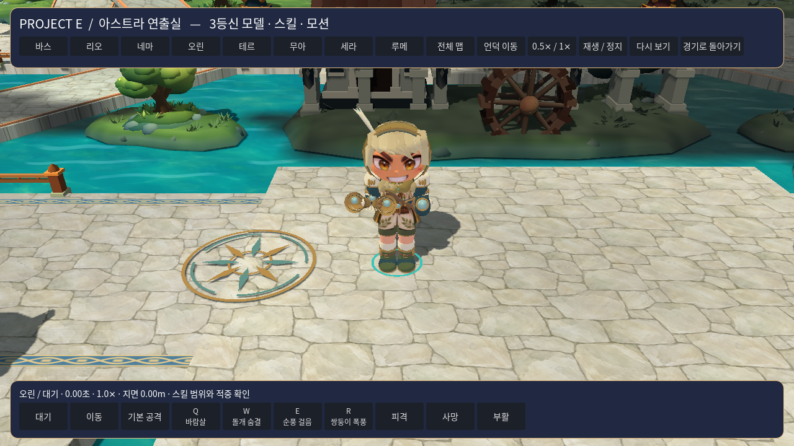
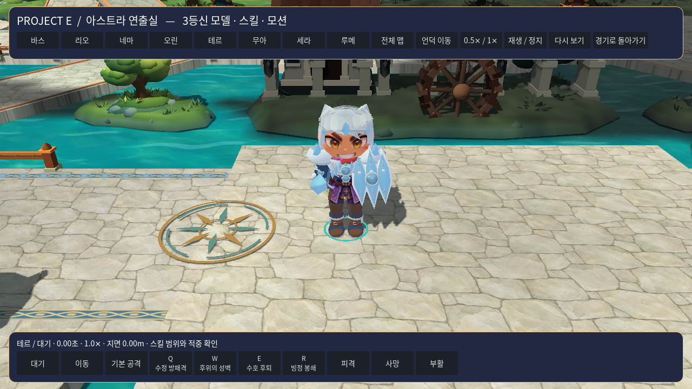
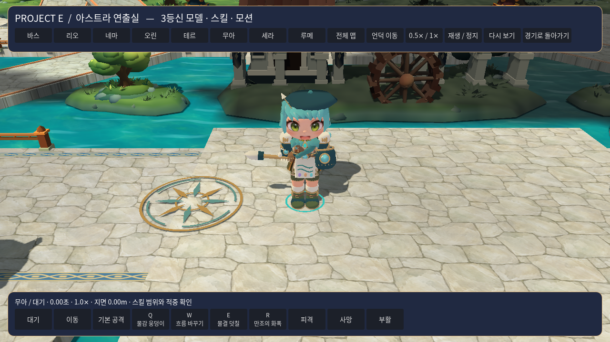
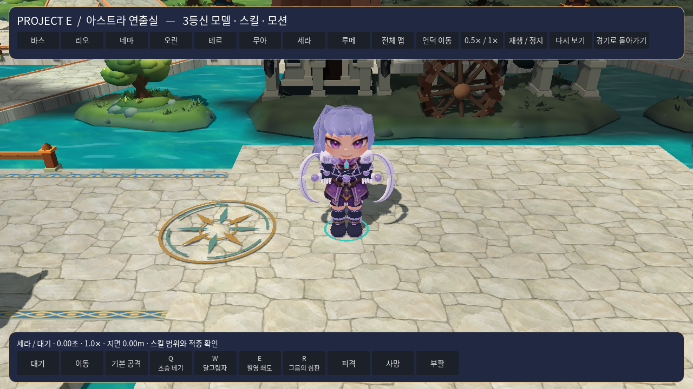
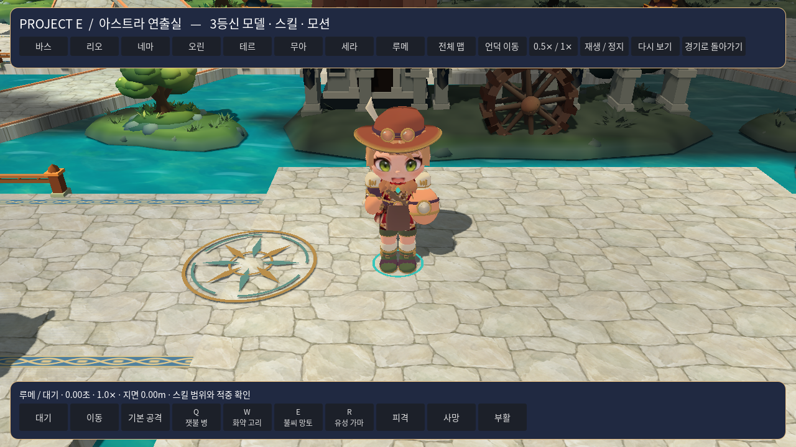
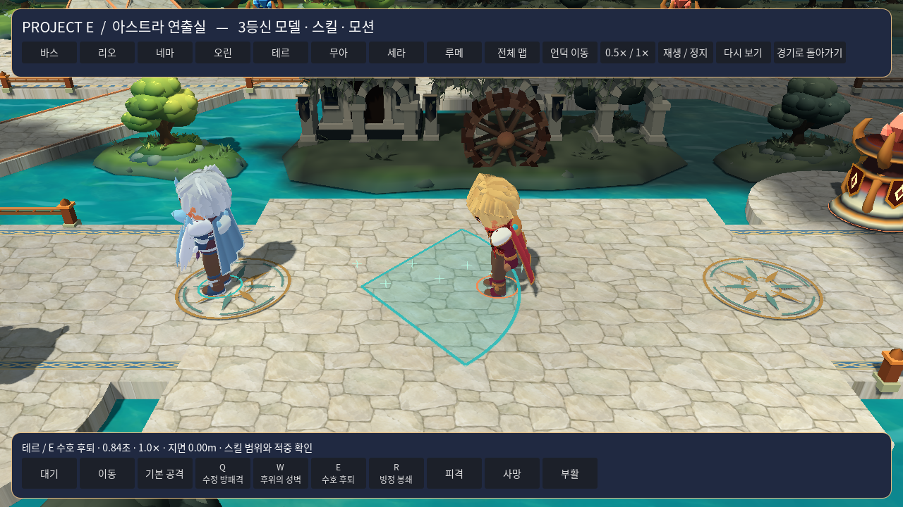
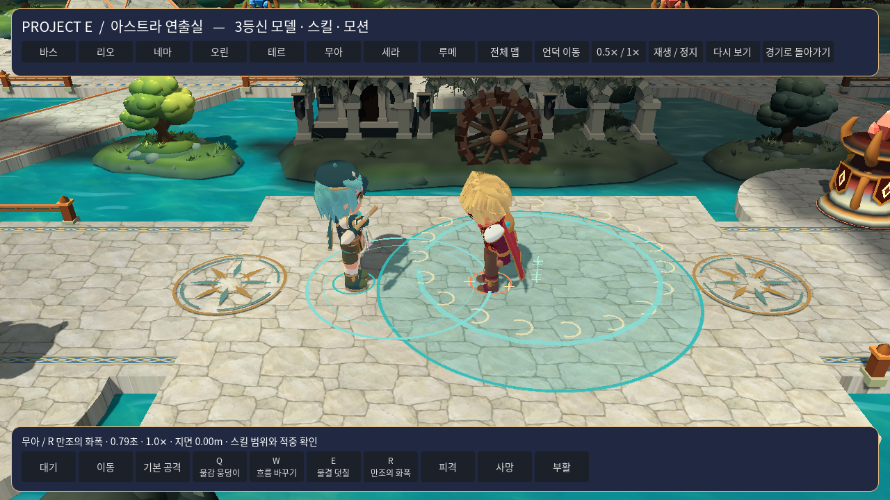

# V8 실제 실행 화면

2026-11-09에 Windows 배포용으로 내보낸 PCK를 Godot 4.7.2의 실제 렌더러에서 실행해 촬영했다. 촬영 환경은 Linux의 OpenGL 호환 렌더러다. 화면 검사는 319개 항목을 통과했고, 전체 촬영본은 57장이다. 이 폴더에는 그중 8장을 원본 그대로 보관한다. [전체 촬영 목록과 SHA-256](player-review.json)

촬영 소스는 `db321f0867230ef06f3f1de89300ab3488598f25`의 PR 통합 빌드다. 해당 빌드는 선택 화면 3개 해상도, 8명 포인터 선택, 32개 기술, 상점과 소모품을 검사했다. 이후 이동 보완과 최신 실행 결과는 V8 검증 기록에서 확인할 수 있다. [촬영 CI](https://github.com/herothgf-cell/project-e/actions/runs/42574434669) · [전체 촬영 아티팩트](https://github.com/herothgf-cell/project-e/actions/runs/42574434669/artifacts/13654677736) · [V8 검증 기록](../../verification/2026-11-09-v8-verification.md)

## 8명 선택

기존 3명은 일러스트 초상을, 신규 5명은 실제 모델의 상반신 초상을 사용한다. 영웅 카드와 오른쪽 기술 설명, 일반 경기·기술 체험, 시작 버튼을 한 화면에 배치했다.

## 신규 5명 모델

얼굴과 의상에 기존 텍스처를 재사용하고 머리 장식·외투·무기와 관절 포즈를 각 역할에 맞춰 구성했다. 각 화면은 F7 연출실에서 실행 중인 모델이다.

### 오린

두건, 깃털, 두 송풍관과 가벼운 장비로 바람 사수의 실루엣을 구성했다.

### 테르

수정 관, 어깨 갑옷과 긴 접이식 방패로 보호 역할을 표현했다.

### 무아

베레모와 앞치마, 붓통과 가로로 든 붓을 사용한다.

### 세라

묶은 머리와 짧은 망토, 초승달 형태의 쌍검으로 빠른 근접 역할을 표현했다.

### 루메

고글이 달린 둥근 모자, 가죽 앞치마와 연금 병을 사용한다.

## 기술의 실제 판정과 표시

테르 E는 뒤로 이동한 뒤 출발점에서 반대 방향으로 반격한다. 촬영 시점은 실제 돌진과 지연 반격이 끝난 직후다. 더미에 피해가 발생하는 것도 행동 검사로 확인했다.

무아 R은 활성 물감 구역을 소비하고 확장된 물결과 속박을 만든다. 아래 화면은 실제 기술 시전으로 준비한 구역과 발동 효과다.

[게임허브](../../README.md) · [8명 상세 시트](../../characters/README.md) · [미술과 음향 기획](../../content/09-art-and-audio.md)
