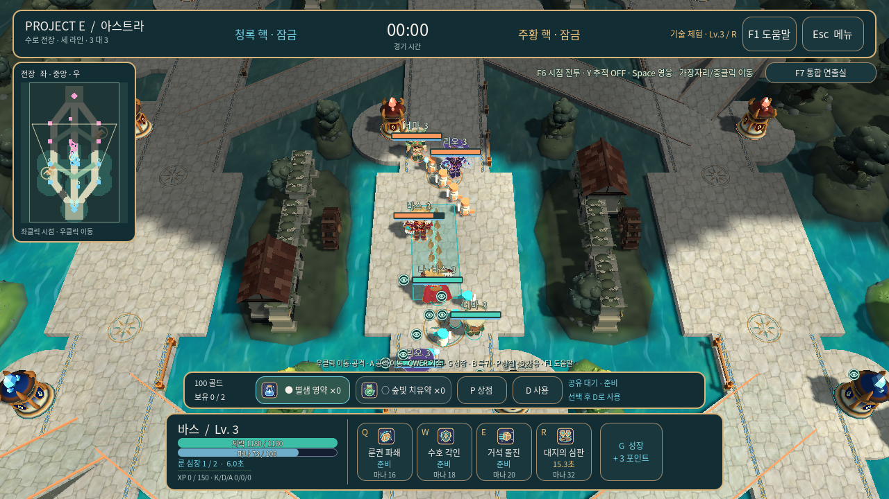
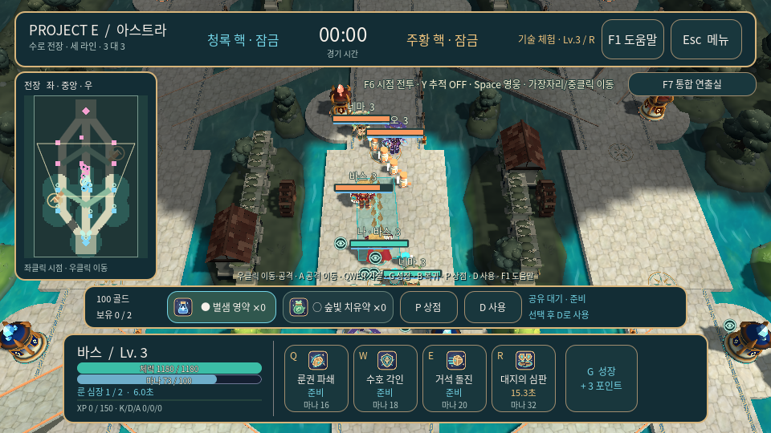
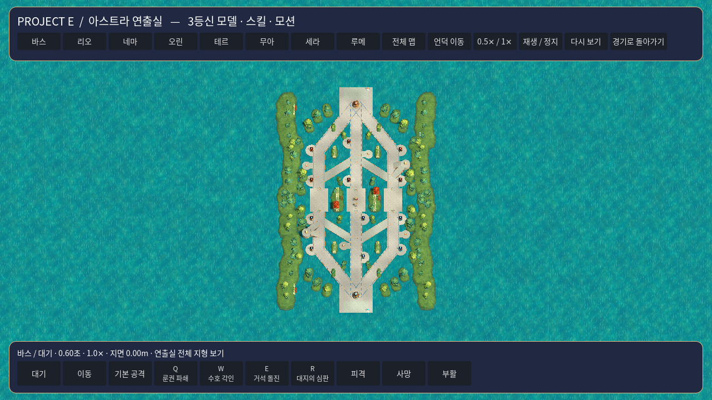
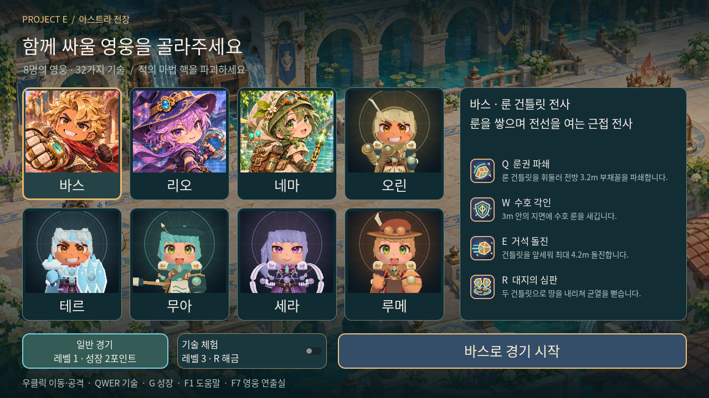

# V9 실제 배포 화면

아래는 V9 Windows 배포에 들어가는 **실제 PCK**를 Linux X11/OpenGL 호환 렌더러에서 실행한 화면이다. 생성한 컨셉 이미지가 아니다. 코드 커밋은 `200df52e018e46b5b7847bfd808c59206dca7a75`, 촬영·내보내기용 PR 통합 커밋은 `8c16d45a58ae1bcc7dc2035b9b72aa6497c1467d`다. 배포 manifest의 제품 스크립트 31개가 게시 코드와 같은 것을 확인했다.

기존 화면·포인터 검사 **319개와 57장 촬영**, 세로 전장 검사 **23개와 3장 촬영**을 모두 통과했다. 이 폴더에는 선택 화면 1장과 세로 전장 3장을 원본 그대로 보관했다. 기존 57장 모두 촬영 manifest의 SHA-256과 대조했고, 보관 파일도 별도 목록에 해시를 기록했다. [화면 검사 manifest](player-review.json) · [세로 검사 manifest](vertical-review.json) · [보관 파일 해시](captured-files.json)

[촬영·Windows 검사 CI](https://github.com/herothgf-cell/project-e/actions/runs/42801891061) · [전체 촬영 아티팩트](https://github.com/herothgf-cell/project-e/actions/runs/42801891061/artifacts/13755494347) · [V9 검증](../../verification/2026-11-10-v9-verification.md)

## 세로 전장, 1280×720

하단 아군과 상단 적군, 세로 중앙 도로, 좌·중·우 미니맵을 같은 기준으로 표시한다. 미니맵의 카메라 영역과 팀 시야도 이 방향을 따른다.

이 전투 화면은 실제 장면·스킬 판정·정상 안개를 사용하는 **배치된 기술 시연 상황**이다. 자연 경기의 특정 순간이나 밸런스 측정 화면으로 해석하지 않는다.

## 작은 화면, 960×540

등비 세로 미니맵과 인벤토리·기술 HUD를 함께 표시한다. 지도 패널 아래와 인벤토리 사이에는 간격을 두고, 지도 여백 클릭은 월드 이동 명령으로 전달하지 않는다.

## F7 전체 전장

전체 지도 보기에서는 지형과 목표를 공개해 배치를 점검한다. 실제 경기와 별도 상태를 쓰며 원래 경기의 시야를 공개하지 않는다.

## 8명 선택

V8에서 확장한 바스·리오·네마·오린·테르·무아·세라·루메 선택을 유지한다.

[게임허브](../../README.md) · [전장 상세](../../content/02-map-and-vision.md) · [UI와 카메라](../../content/08-ui-and-camera.md)
