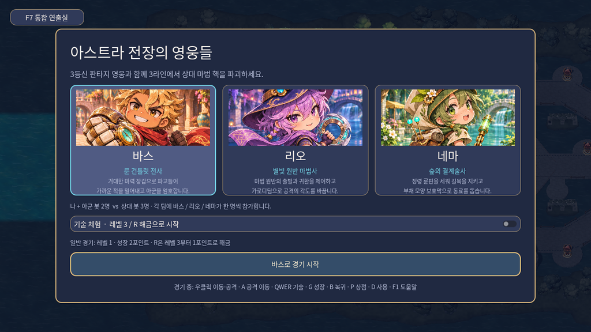
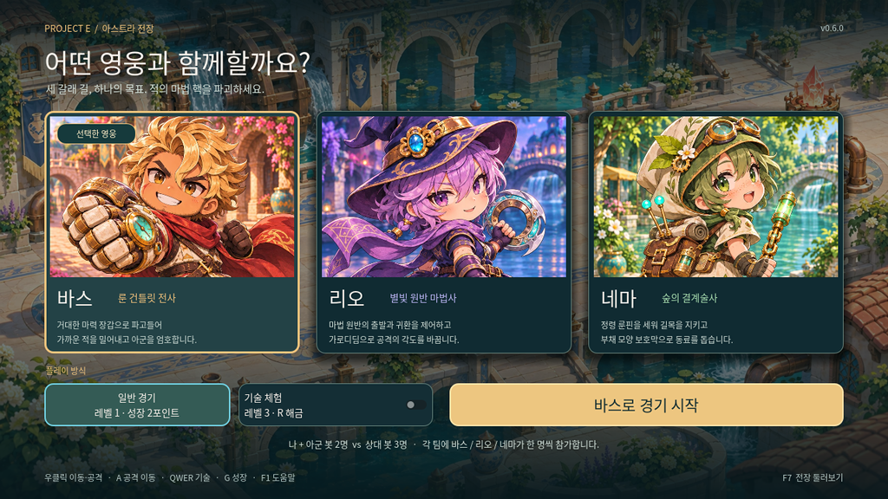
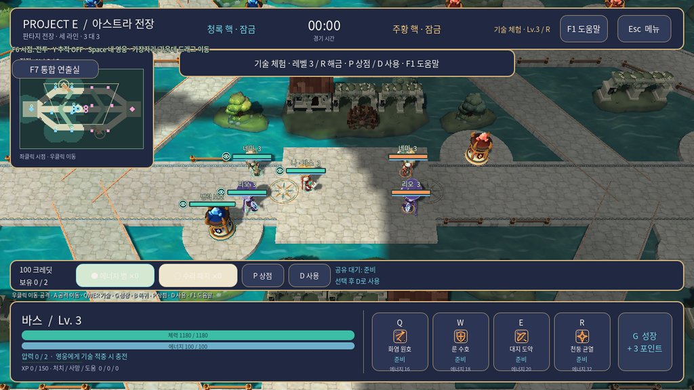
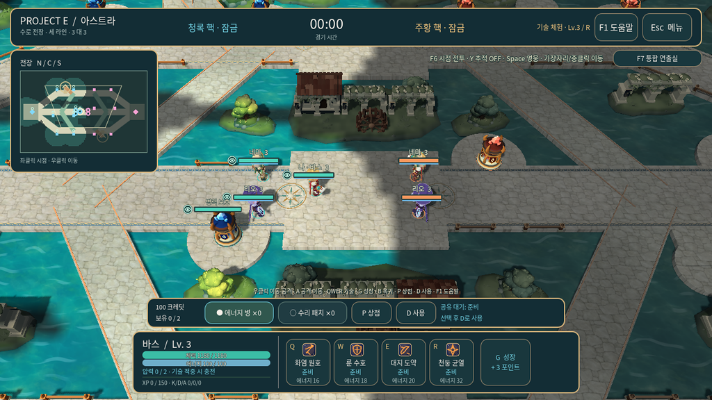

# 2026-11-06 V6 화면·카메라 검증

## 검증한 소스와 실행본

검증한 PR 헤드는 `031c2f152ab0f4ad29d3068778d9fe06f6322569`다. Windows 배포 작업이 체크아웃한 병합 소스는 `6348f8d1117fecb533e7f7b62e3ea357713aa50c`이며, 두 커밋의 트리는 `fa8a22afff9d59cd2fff4646211f917b1873b621`로 같다. 애플리케이션 버전은 `0.6.0`이다.

[Windows V6 실행본 다운로드](https://github.com/herothgf-cell/project-e/actions/runs/42182235282/artifacts/13485986289) · [수정 PR](https://github.com/herothgf-cell/project-e/pull/8)

GitHub 로그인 후 `ProjectE-V6-Windows-preview`를 내려받는다. 바깥 압축을 풀고 `ProjectE-windows-x86_64.zip`을 다시 푼 뒤 `ProjectE.exe`를 실행한다. 실행 파일과 `ProjectE.pck`는 함께 둔다. 선택 화면 오른쪽 위에서 `v0.6.0`을 확인할 수 있다. 이 Actions 다운로드의 보관 기한은 2026-11-20이다.

| 파일 | 바이트 | SHA-256 |
|---|---:|---|
| ProjectE.exe | 109268480 | `d34d36f3be1a6c49c56525ae86469b92e4f417ddf0b43cf00dd80c385c4b0562` |
| ProjectE.pck | 14837288 | `fceb67e8943e81fd33de62805dd3796f1ee25a77640284b801e3c054b1155959` |
| 내부 Windows ZIP | 패키지의 sha256 파일로 확인 | `07634bf79068b6f1ed628a02aa327da688cbd769d047666cfcd671712963403d` |

## 실행 결과

| 검사 | 확인한 결과 |
|---|---|
| Godot 4.7.2 자산 가져오기와 시작 장면 | 통과 |
| 전체 행동 회귀 검사 | 28개 스위트, 4,743개 항목, 실패 0 |
| 영웅 선택 V6 | 49개 항목, 실패 0 |
| 카메라 V6 | 56개 항목, 실패 0 |
| PDF 적용 전투 규칙 | 50개 항목, 실패 0 |
| 이동·공격 입력 | 32개 항목, 실패 0 |
| 소모품 입력 | 115개 항목, 실패 0 |
| 경험치 미터 | 14개 항목, 실패 0 |
| Windows release 내보내기 | EXE·PCK 헤더와 ZIP 내부 파일 해시 검증 통과 |
| 배포 PCK 화면·입력 검사 | 73개 항목 통과 |
| Windows 실행 파일 기동 | Windows CI에서 headless 120프레임 실행, 종료 코드 0 |

[전체 회귀 실행 기록](https://github.com/herothgf-cell/project-e/actions/runs/42182235353) · [Windows 패키지·실행·화면 검사](https://github.com/herothgf-cell/project-e/actions/runs/42182235282) · [실제 경기 렌더 검사](https://github.com/herothgf-cell/project-e/actions/runs/42182235234)

선택 화면은 1280×720, 1366×768, 960×540에서 검사했다. 가장 작은 창에서는 실제 GUI 포인터 이벤트로 바스·리오·네마를 선택하고, 일반 경기와 기술 체험을 전환하고, 선택한 네마로 경기를 시작한 뒤 선택 화면으로 돌아오는 흐름을 실행했다. 960×540 전투 화면에서는 낮은 체력·에너지, 알림, 대상 정보, 카메라 안내, 하단 HUD의 화면 안 배치와 겹침을 확인했다.

## 실제 수정 전후

아래 이미지는 Godot Compatibility 렌더러가 배포 PCK를 열어 촬영한 결과다. 문서에는 1024×576 축소본을 사용했다. 경기 화면은 재현을 위해 영웅 위치와 시간을 고정했다. 원본 해상도 이미지와 촬영 해시는 `ProjectE-V6-player-review` 아티팩트에 있다.

| 화면 | 수정 전 | V6 |
|---|---|---|
| 영웅 선택 |  |  |
| 전투 HUD |  |  |

[960×540 낮은 체력 상태](../assets/v6/battle-low-health-960x540.webp) · [원본 화면 아티팩트](https://github.com/herothgf-cell/project-e/actions/runs/42182235282/artifacts/13485801839)

수정 전 이미지는 UI 변경 전 커밋 `27189facb6981308edd33bdfbe6a10675d9075f3`에서 같은 촬영 도구로 얻었다. V6 이미지는 위에 기록한 `031c2f1`의 배포 PCK에서 얻었다.

## 구현 판단

- 선택 화면은 기존 영웅 일러스트와 운하 원화를 사용했다. 352×232의 초상 영역, 영웅별 역할·설명, 선택 표시, 일반 경기·기술 체험 버튼으로 구성했다.
- 카메라의 기본 동작은 부드러운 영웅 추적이다. 화면 안쪽에서 가장자리로 들어가면 자유 시점으로 전환한다. 720픽셀 기준 32픽셀의 가장자리 범위에서 이동 속도가 점차 커지며, HUD가 있는 가장 바깥 10픽셀도 이동할 수 있다. Y는 추적 전환, Space는 영웅 복귀, 가운데 버튼 드래그는 자유 이동이다.
- 창 포커스 상실, 모달, 텍스트 입력 포커스, 화면 밖 포인터, 재중앙 정렬 시의 가장자리 입력을 검사했다.
- PDF 4쪽의 일반 병사 막타 예약 규칙을 적용했다. 현재 전투 수치에 맞춘 잔여 체력은 1 HP로 정했다. 일반 병사는 해당 적을 놓고 다음 적을 찾거나 라인을 따라 전진한다. 영웅·공성 병사·포탑은 처치할 수 있다. 적용 근거는 [PDF 대응 문서](../26-cot-reference-v6.md)에 있다.

## 회귀 검사에서 수정한 문제

UI 수정 전에는 큰 초상 영역 검사 9개와 하단 HUD 높이 검사가 실패했다. 새 배치에서 해당 검사가 통과했다.

전체 회귀 검사에서는 경험치 문자열 형식과 미터 여백, 경기 시작 직후 알림의 클릭 차단, 상단 바의 실제 최소 높이로 인한 카메라 안내 겹침을 발견했다. 경험치 표시 계약을 복원했고, 알림은 클릭을 통과시키며 초기 줄바꿈 폭을 먼저 설정하도록 했다. 카메라 안내와 F7 버튼은 y90–120에 배치하여 실제 상단 바 높이를 피했다.

## 재현

```sh
python tools/check_godot.py --godot /absolute/path/to/Godot_v4.7.2-stable_linux.x86_64
xvfb-run -a /absolute/path/to/Godot_v4.7.2-stable_linux.x86_64 --main-pack /absolute/path/to/ProjectE.pck --rendering-method gl_compatibility --audio-driver Dummy --script /absolute/path/to/tools/art/capture_player_view.gd -- --output=/absolute/path/to/player-review
```

배포 PCK의 화면·입력 검사는 Linux의 Xvfb와 소프트웨어 OpenGL에서 실행했다. Windows 기동 검사는 headless 방식으로 실행했다. 사용자 PC에서의 장시간 수동 조작, 실제 GPU 프레임 성능, 조작감 평가는 추가 검증이 필요하다.
