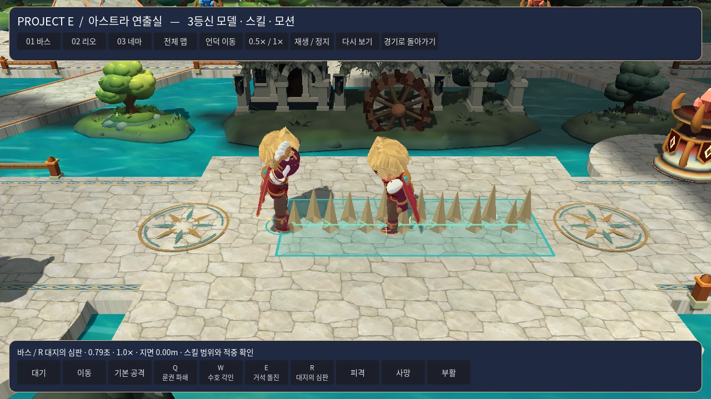
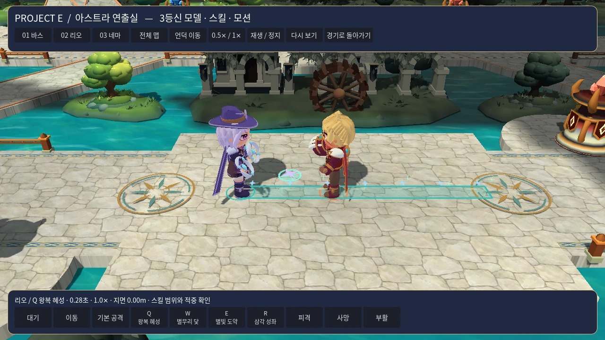
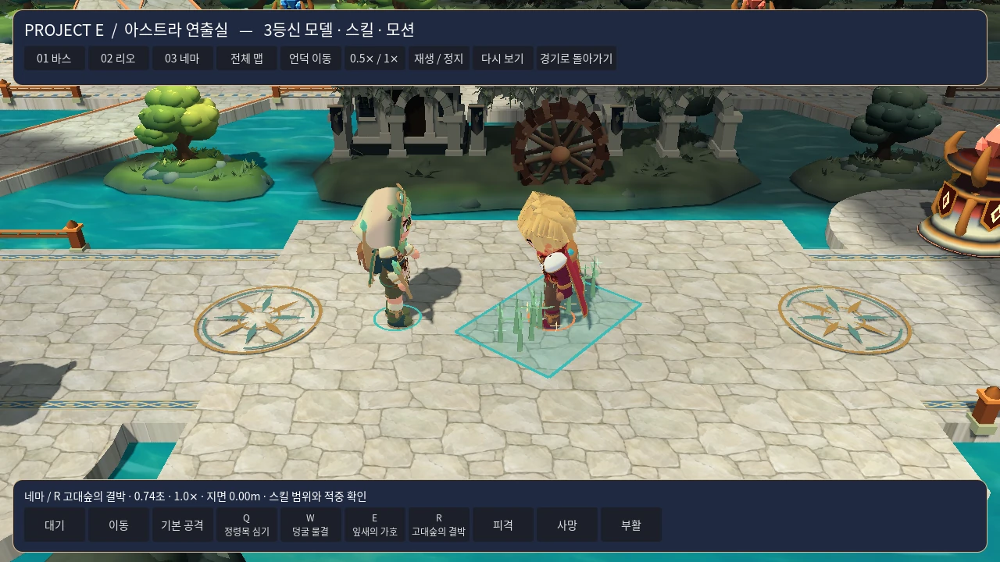
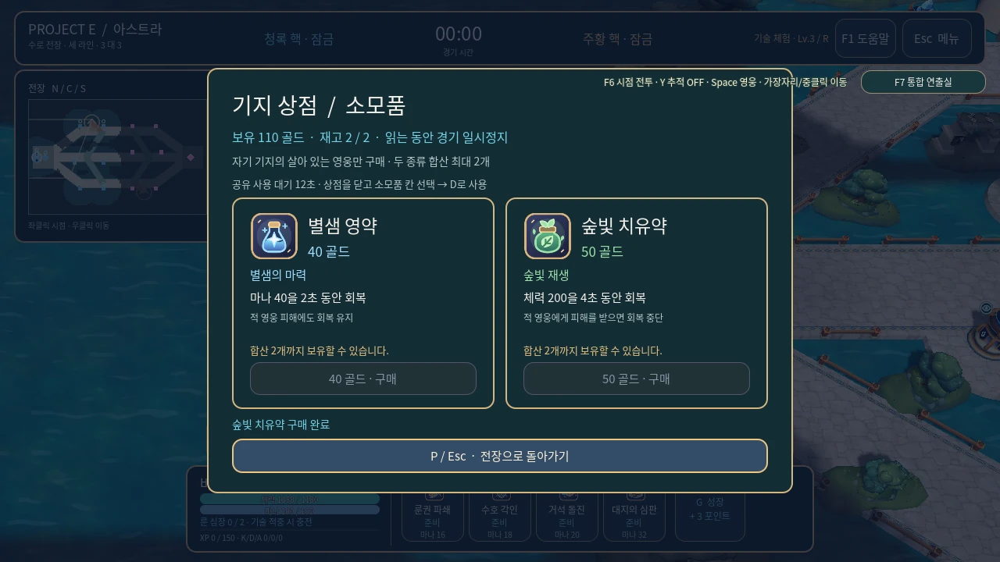

# 2026-11-06 V7 판타지 스킬·아이템 검증

## 변경 범위

패시브 3개와 QWER 12개의 이름·설명, 12개 스킬 아이콘, 시전 효과, 리오의 비행 원반과 별무리 닻, 네마의 정령목·연결 덩굴을 현재 영웅 콘셉트로 구성했다. 상점의 두 소모품은 별샘 영약과 숲빛 치유약이며, 전용 아이콘·회복 효과·사용음을 연결했다. HUD, F7 연출실, 캐릭터 문서는 실제 스킬·아이템 데이터를 따른다. [V7 구성](../27-fantasy-skills-v7.md)

## 전체 검사와 배포 화면

첫 통합 검증 소스는 `92d96adeca8c206fe2656254a362e6ad2334c1e9`이며 트리는 `329027d64e51179a72e7d008fca53ee2fecd5a34`다. 애플리케이션 버전은 `0.7.0`이다. 아래 수치는 이 소스에서 완료된 실행 기록이다. 성능 보정 이후의 최종 소스와 빌드 결과는 PR의 최신 검사 기록에 연결한다. [수정 PR](https://github.com/herothgf-cell/project-e/pull/9)

| 검사 | 결과 |
|---|---|
| Godot 4.7.2 가져오기·시작 장면 | 통과 |
| 전체 행동 회귀 | 33개 스위트, 5,835개 항목, 실패 0 |
| 스킬 이름·설명·아이콘 | 191개 항목, 실패 0 |
| 아이템 데이터·아이콘 | 36개 항목, 실패 0 |
| 판타지 HUD | 96개 항목, 실패 0 |
| 지속 효과·회복·음향 | 227개 항목, 실패 0 |
| SVG 자산 | 21개 파일, XML·크기 검사 통과 |
| 배포 PCK 화면·입력 | 129개 항목, 실패 0, 실제 화면 22장 |
| Windows 실행 파일 | Windows CI에서 headless 120프레임 기동, 종료 코드 0 |

[전체 회귀 실행](https://github.com/herothgf-cell/project-e/actions/runs/42204708579) · [배포 패키지·PCK 촬영·Windows 기동](https://github.com/herothgf-cell/project-e/actions/runs/42204708638) · [통합 렌더 검사](https://github.com/herothgf-cell/project-e/actions/runs/42204708785)

촬영 도구는 Windows 배포용 `ProjectE.pck`를 `--main-pack`으로 열고 Linux Xvfb의 소프트웨어 OpenGL에서 실행했다. 1280×720·1366×768·960×540 선택 화면, 960×540 전투 HUD, 두 크기의 상점, 두 회복 아이템, 세 영웅의 QWER를 촬영했다. 최초 캡처 목록의 `source` 표시는 엔진이 소비한 명령행 인자를 다시 읽으면서 `source checkout`으로 기록됐으며, 촬영 경로는 CI의 `--main-pack` 명령으로 확인했다. 후속 빌드에는 명시적인 `--exported-pck` 캡처 표시를 연결했다.

아래 화면은 첫 통합 검증 PCK의 실제 렌더다. 영웅 위치와 효과 시간을 고정한 재현 장면이며, 원본 22장과 개별 SHA-256은 화면 아티팩트에 있다. [원본 화면](https://github.com/herothgf-cell/project-e/actions/runs/42204708638/artifacts/13496186509)

### 바스 · 대지의 심판



### 리오 · 왕복 혜성



### 네마 · 고대숲의 결박



### 소모품 상점



## 연출 계산 비용 보정

독립 검토에서 삼각형마다 전체 시야 제공자를 다시 수집하고 벽·높이를 반복 확인하는 비용을 발견했다. 갱신마다 현재 시야 제공자를 한 번 수집하며, 효과 전체의 경계 사각형이 한 관측자의 시야에 들어오고 벽·고지 조건을 만족할 때 공통 검사를 재사용한다. 경계에 걸리는 효과는 기존의 개별 시야·벽·지면 함수를 호출한다. 모든 삼각형에 7개 표본과 실제 판정 범위 검사를 수행한다.

| 중앙 라인 단일 궁극기 | 보정 전 애니메이션 갱신 | 보정 후 애니메이션 갱신 | 삼각형 |
|---|---:|---:|---:|
| 바스 R | 18.71ms | 1.84ms | 138 |
| 리오 R | 14.29ms | 1.43ms | 92 |
| 네마 R | 23.88ms | 2.08ms | 168 |

수치는 독립 검토 환경에서 효과 시간과 전투 시간을 바꾸며 60회 갱신한 CPU 지오메트리 생성 평균이다. 실제 범위를 만드는 `preview()` 결과를 사용했다. 벽·시야·고지 경계에서는 개별 판정 경로를 사용한다.

보정 전 소스와 전체 메시 정점 배열을 비교한 260개 사례가 모두 일치했다. 12개 스킬, 이동 중인 돌진, 관측자 이동·사망·복귀, 벽 추가·제거, 고지·경사로, 낮은 지면·높은 지면·포탑 관측자, 고지 정보 변경을 포함한다. 최종 VFX 집중 검사는 시야·벽·높이 호출량과 즉시 갱신을 포함해 52개 항목을 통과했다.

## 사용 조건 확인

- 별샘 영약은 마나 40을 2초 동안 회복한다. 숲빛 치유약은 체력 200을 4초 동안 회복하며 적 영웅의 유효 피해로 중단된다. 합산 보유량 2개와 공용 사용 대기시간 12초를 검사했다.
- 실제 구매·선택·사용, 회복 완료·중단, 사망, 일시정지와 사용음의 최초 1회 재생을 확인했다.
- 아군에게 알려진 리오의 비행 원반 경로와 적 투사체의 현재 시야 조건을 각각 검사했다. 네마의 정령목은 수명과 연결 상태를 따르며, 잎·덩굴은 해당 전투 판정 범위에 맞춰 그린다.
- UI 설명에는 리오 Q의 왕복 동일 대상 적중, W의 귀환 시작 시 닻 소비, E의 돌진 이후 강화 공격, 네마의 연결 거리·나무 회복·재진입 조건을 실제 수치로 표시했다.

## 재현

```sh
python tools/check_godot.py --godot /absolute/path/to/Godot_v4.7.2-stable_linux.x86_64
python tools/check_art_assets.py
python tools/check_audio_assets.py
python -m unittest discover -s tools/tests -p 'test_package_windows.py'
xvfb-run -a /absolute/path/to/Godot_v4.7.2-stable_linux.x86_64 --main-pack /absolute/path/to/ProjectE.pck --rendering-method gl_compatibility --audio-driver Dummy --script /absolute/path/to/tools/art/capture_player_view.gd -- --output=/absolute/path/to/player-review --exported-pck
```

실행 확인 범위는 Windows headless 기동, Linux 소프트웨어 렌더러 화면·입력 검사, 자동 전투 회귀와 CPU 연출 측정이다. 사용자 PC의 장시간 조작감과 GPU 프레임 성능은 별도 플레이 확인이 필요한 항목이다.
