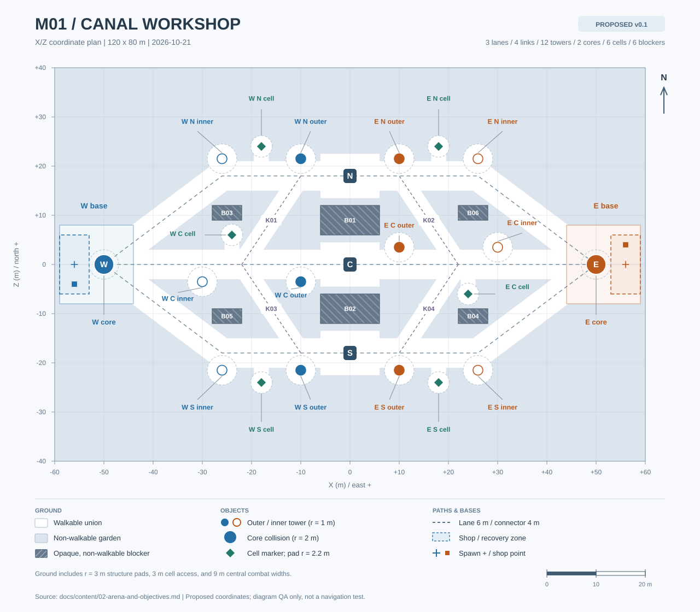

# M01 수로 공방 — 지형과 공성

- 버전/작성일: v0.1 / 2026-10-21
- 상태: 독자 지형의 회색 상자 제작용 제안. 좌표·폭·거리·수치는 플레이테스트로 조정한다.
- 범위: 이동 가능한 지면, 세 라인, 연결로, 구조물, 셀, 시야와 지원 시간.
- 관련: [공통 규칙](../01-core-rules.md), [세계관](01-world-and-presentation.md), [병력·경제](03-minions-and-economy.md), [검증 계획](../04-playtest-and-balance.md)
- 이번 설계의 기준: 3대3·세 라인·빠른 인접 지원·성장과 공성 판단을 채택한다. 아래 배치는 신규 설계다.
- 판정 우선순위: 공통 전투 수치는 공통 규칙이 우선하고, 이 문서가 M01의 좌표와 지형을 정한다.

## 배치도

흰색은 이동 지면, 사선 무늬는 불투명 차단체다. 원형은 방어탑/핵, 마름모는 경험치 셀이며 전체 축척은 아래 좌표와 같다. [SVG 원본](arena-m01.svg)을 확대해서 볼 수 있다.

## 1. 좌표와 지면

| 항목 | M01 제안 |
|---|---|
| 전체 경계 | 120×80m, X −60~+60 / Z −40~+40 |
| 좌표 의미 | X가 서→동, Z가 남→북, 위쪽을 북 N으로 부름 |
| 팀 | 서쪽 팀 W, 동쪽 팀 E; 경기 UI의 아군/적군 표시와 분리 |
| 핵 중심 | W (−50,0), E (50,0) |
| 부활 중심 | W (−56,0), E (56,0) |
| 상점/회복 구역 | W [−59,−53]×[−6,6], E [53,59]×[−6,6] |
| 상점 상호작용점 | W (−56,−4), E (56,4); 구역 안에서는 상점 패널 사용 가능 |
| 지면 충돌 | 모든 영웅 반경 0.45m, 같은 평면에서 판정 |
| 구조물 충돌 외곽 | 방어탑 반경 1m, 핵 반경 2m인 원으로 시작 |

상점/회복 구역은 상시 무적 구역이 아니다. 적의 공격·진입을 특별히 차단하지 않는다.
부활 후 3초 보호와 기지 회복의 조건은 공통 규칙을 따르며, 기지에서 공격하면서 보호받는 상황을 허용하지 않는다.
회색 상자의 이동 가능 지면은 아래의 라인 통로·연결 통로·기지·발판·측면 진입로의 합집합으로 만든다.
기지 지면은 W [−59,−44]×[−8,8], E [44,59]×[−8,8]이다.
라인 통로는 각 중심 경로에서 양쪽 3m, 총 폭 6m인 띠다. 꺾이는 점은 반경 3m의 둥근 접합으로 연결한다.
연결 통로는 중심선 양쪽 2m, 총 폭 4m이며, 출입구에서 라인 통로에 자연스럽게 합쳐진다.
구조물마다 반경 3m 발판을 추가하되 실제 구조물 충돌 원은 이동 지면에서 뺀다.
셀은 반경 2.2m 발판과 가까운 라인 중심까지 폭 3m 진입로로 연결한다.
세 라인의 중앙 X −6~6에는 폭 9m 교전 공간을 둔다. 중심 Z는 각각 18,0,−18이다.
그 밖의 정원과 수로는 비이동 지면이다. 보이는 장식 발판이 새 지름길처럼 읽히지 않게 한다.

## 2. 세 라인의 경로

| 라인 | W 핵에서 E 핵까지 중심 경로 | 계산 | 중심 경로 길이 |
|---|---|---|---:|
| N 북쪽 | (−50,0) → (−26,18) → (26,18) → (50,0) | 30+52+30 | 112m |
| C 중앙 | (−50,0) → (50,0) | 직선 | 100m |
| S 남쪽 | (−50,0) → (−26,−18) → (26,−18) → (50,0) | 30+52+30 | 112m |

북·남의 첫 대각 구간은 √(24²+18²)=30m다. 한 핵에서 중앙선까지는 N/S 56m, C 50m다.
100/112m는 핵 중심을 잇는 기준 경로이며, 구조물 충돌 우회나 영웅의 자유로운 경로 선택을 강제하는 수치가 아니다.
병력은 해당 중심 경로를 따르며 연결로로 갈아타지 않는다. 각 팀의 생성 앵커는 핵에서 자기 라인 방향으로 5m 전방이다.
따라서 최초 교전까지 선두 병력의 명목 이동은 C 45m, N/S 51m다.
이동속도 3.2m/s에서 첫 웨이브의 중앙선 도착은 약 34.06초/35.94초이며 생성 시각 20초를 포함한다.
이 값은 충돌·공격·편대 간격이 없는 계산이다. 실제 교전 시작은 측정으로 확인하고 중심 경로를 슬쩍 늘려 맞추지 않는다.
기지에서 모든 라인을 즉시 바라볼 수 있어야 한다는 조건은 없다. 기지 출발 때 N/C/S 표식과 미니맵 경로를 제공한다.

## 3. 네 개의 인접 라인 연결로

| ID | 중앙 라인 측 출입점 | 북/남 라인 측 출입점 | 중심선 길이 |
|---|---|---|---:|
| K01 W 북 | (−22,0) | (−10,18) | √(12²+18²)=21.63m |
| K02 E 북 | (22,0) | (10,18) | 21.63m |
| K03 W 남 | (−22,0) | (−10,−18) | 21.63m |
| K04 E 남 | (22,0) | (10,−18) | 21.63m |

| 이동 조건 | 바스 5.8m/s | 리오 6.2m/s | 네마 6.0m/s |
|---|---:|---:|---:|
| 한 연결로 중심 출입점 사이 | 3.73초 | 3.49초 | 3.61초 |
| 이동 성장 3회(+0.45m/s) 후 | 3.46초 | 3.25초 | 3.35초 |
| 같은 측 북↔남, 중앙 경유 43.27m | 7.46초 | 6.98초 | 7.21초 |

인접 지원 3–5초 가설은 중앙선상의 출입점 두 곳 사이를 기본 이동으로 건너는 조건이다.
전투 위치에서 출입점까지 접근하는 거리, 충돌·감속·공격·개별 기동기는 위 계산에 포함하지 않는다.
폭이 있는 통로의 가장자리를 따라 이동하면 중심선 계산보다 짧아질 수 있다. 검증 영상에는 실제 출발·도착 위치를 함께 기록한다.
북에서 남으로 직접 이어지는 통로나 전 맵 순간이동은 없다. 세 라인이 같은 위치에 접힌 전장도 만들지 않는다.
연결로 양 끝은 전투 지점에 가깝다. 이동 중 상대 병력·영웅에게 발각되거나 퇴로를 차단당할 수 있다.
지원 후 원래 라인으로 돌아갈지는 병력 손실과 타워 상태로 판단하게 하며, 이동 보상이나 통로 점령 버프를 추가하지 않는다.

## 4. 방어탑 배치

| 라인 | W 내곽 | W 외곽 | E 외곽 | E 내곽 |
|---|---|---|---|---|
| N | (−26,21.5) | (−10,21.5) | (10,21.5) | (26,21.5) |
| C | (−30,−3.5) | (−10,−3.5) | (10,3.5) | (30,3.5) |
| S | (−26,−21.5) | (−10,−21.5) | (10,−21.5) | (26,−21.5) |

타워는 중심 경로 옆 3.5m에 두어 미니언의 기준 경로를 막지 않는다. 이동 가능한 발판이 근접 공성 접근을 제공한다.
중앙 타워의 남/북 오프셋과 기지 장식은 180도 회전 대칭으로 배치한다.
북·남의 기능 지형도 회전 대칭이며, 온실·건조대 등의 장식 차이가 기능 차이가 되지 않게 한다.
북/남 외곽타워 중심 간격은 20m다. 사거리 9m 원 두 개 사이에는 2m의 중심축 간격이 남는다.
중앙 외곽타워 간 거리는 √(20²+7²)=21.19m이며, 두 사거리 원 사이 최소 간격은 3.19m다.
이 값은 반경 9m 표시 원 사이의 거리다. 표적 외곽까지 재는 공격 규칙 때문에 반경 0.45m 영웅 중심의 안전 간격은 각각 약 1.10m·2.29m로 더 좁다.
타워의 사거리와 병력 보호 해제 반경은 구조물 중심에서 측정한다. 근접 공격 사거리는 표적의 피격 외곽까지 잰다.
타워 장식이 발판을 넘어도 충돌 원을 키우지 않으며, 타워 뒤에 숨은 유닛의 발밑 표식을 가리지 않는다.

## 5. 잠금·병력 보호·승리

| 상태 | 실제 규칙 | 화면 표시 |
|---|---|---|
| 외곽탑 | HP 2,000, 처음부터 공격 가능 | 외곽 이름과 일반 체력 막대 |
| 내곽탑 잠금 | 같은 라인의 외곽 파괴 전에는 피해 없음 | 자물쇠와 ‘같은 라인 외곽탑 파괴 필요’ |
| 내곽탑 해제 | HP 2,600, 외곽이 파괴된 라인만 공격 가능 | 잠금 제거, 남은 HP 그대로 |
| 핵 잠금 | 어느 한 라인의 외곽+내곽이 모두 파괴되기 전에는 피해 없음 | 핵 아이콘의 잠금 |
| 핵 노출 | 한 라인 개통 후 영구 해제, HP 4,000, 공격 없음 | 전체 팀에 공개 노출 알림 |
| 병력 부재 보호 | 공격 팀 라인 병력이 구조물 중심 12m 안에 없으면 받는 피해 30% | 방패와 ‘아군 라인 병력 필요’ |
| 승패 | 핵 HP 0이면 종료; 같은 서버 틱 양 핵 파괴는 무승부 | 권한 서버가 확정한 결과 한 번 표시 |

영웅·장치·소환물의 구조물 피해에는 0.5배를 먼저 적용한다. 병력 부재 시 그 결과에 다시 0.3배를 적용한다.
예를 들어 구조물 공격이 가능한 영웅 피해 100은 병력이 있을 때 50, 없을 때 15가 된다.
미니언의 고정 피해에는 영웅 배율 0.5를 적용하지 않는다. 영웅 장치는 라인 병력을 대신해 보호를 해제하지 못한다.
방어탑은 사거리 9m, 고정 피해 180, 공격 간격 1초이며 자동 HP 회복은 없다.
적 병력을 우선하지만 사거리 안의 적 영웅이 아군 영웅을 해치면 해당 영웅을 3초 우선 공격하고 추가 가해로 갱신한다.
타워 사격선과 위험 표식은 현재 영웅 표적을 알려 준다. 세부 타격·시야 판정은 공통 규칙을 따른다.
핵은 반격·시간 제한·체력 재생으로 경기를 끝내지 않는다. 공성 판단이 끝날 때까지 경기 시간을 허용한다.

## 6. 경험치 셀과 부수 공간

| 라인 | W 측 셀 | E 측 셀 | 연결 방식 |
|---|---|---|---|
| N | (−18,24) | (18,24) | 같은 X의 북 라인 Z 18에서 6m 측면 진입 |
| C | (−24,6) | (24,−6) | 중앙 라인에서 6m 측면 진입 |
| S | (−18,−24) | (18,−24) | 같은 X의 남 라인 Z −18에서 6m 측면 진입 |

셀은 총 6개, HP 180, 첫 생성 30초, 파괴 후 45초 재생성이며 이동하거나 공격하지 않는다.
파괴 팀의 근처 영웅이 XP 30·크레딧 10을 공유한다. 셀의 외형상 소속 측과 보상 팀은 다를 수 있다.
셀을 먹기 위해 잠깐 라인에서 빠질지 선택하게 하며 별도 정글 순회·보스·중립 버프를 만들지 않는다.
측면 진입로는 일방통행이 아니다. 들어간 경로로 나올 수 있으며 숨겨진 점프나 낙하 탈출구가 없다.
추가 중립 오브젝트·움직이는 문·수위 변화는 M01의 초기 범위에 없다.

## 7. 시야 차단체

| ID | X 범위 | Z 범위 | 역할 |
|---|---|---|---|
| B01 | −6~6 | 6~12 | 중앙과 북쪽 사이의 낮은 설비 벽 |
| B02 | −6~6 | −12~−6 | 중앙과 남쪽 사이의 설비 벽 |
| B03 | −28~−22 | 9~12 | 서쪽 북 정원의 불투명 공구 보관대 |
| B04 | 22~28 | −12~−9 | B03의 회전 대칭 |
| B05 | −28~−22 | −12~−9 | 서쪽 남 정원의 보관대 |
| B06 | 22~28 | 9~12 | B05의 회전 대칭 |

여섯 차단체는 비이동·불투명 직사각형이며 라인·연결로·셀 발판을 침범하지 않는다.
나머지 비이동 정원은 시야를 가리지 않는다. 벽 재질과 열린 정원 재질을 명확하게 구분한다.
영웅 시야는 12m, 생존한 아군 구조물은 12m, 아군 병력은 8m이며 팀이 공유한다.
셀은 시야를 제공하지 않는다. 안개 속의 셀 재생성이나 적의 셀 공격을 전용 알림으로 알려 주지 않는다.
대상 지정은 현재 보이는 적에게만 시작할 수 있다. 지점 기술은 안개 안에 쓸 수 있지만 숨은 적중 결과를 드러내지 않는다.
벽 높이는 미술 표현이며 실제 가림은 위 직사각형 데이터로 정한다. 창문 장식만 보고 가림 여부가 바뀌지 않게 한다.

## 8. 회색 상자 확인 항목

1. 100m·112m 경로와 네 개 21.63m 연결로를 에디터 측정 기록으로 확인한다.
2. 세 영웅이 양 방향으로 연결로를 걸을 때 기준 출입점 사이 3.49–3.73초인지 확인한다.
3. 폭 4m 연결로에서 두 영웅이 마주 지나가고, 세 영웅이 서면 이동 선택이 달라지는지 본다.
4. 모든 타워를 근접 공격할 수 있고 미니언이 타워 충돌체에 영구 정체되지 않는지 확인한다.
5. 동일한 조합의 동·서 시작 위치와 북·남 배치를 함께 180도 회전해 라인 도착·셀 접근·공성 시간이 대칭인지 비교한다.
6. 잠금과 병력 부재 보호를 각각 켜고, 화면 표시와 실제 피해가 같은지 확인한다.
7. 북↔남 지원이 인접 지원과 같은 시간으로 줄어들지 않고 라인 포기의 비용이 남는지 관측한다.
8. 시야 차단체 여섯 개의 모서리에서 클릭 이동·지점 시전·표적 가림이 일관적인지 확인한다.
9. 중앙 또는 측면 한 라인만 밀어 핵을 노출할 수 있는지, 핵 노출 뒤 잠금이 되살아나지 않는지 확인한다.
10. 결과는 [플레이테스트 계획](../04-playtest-and-balance.md)에 남기고, 이 문서의 제안을 구현·성능 검증 완료로 표시하지 않는다.
